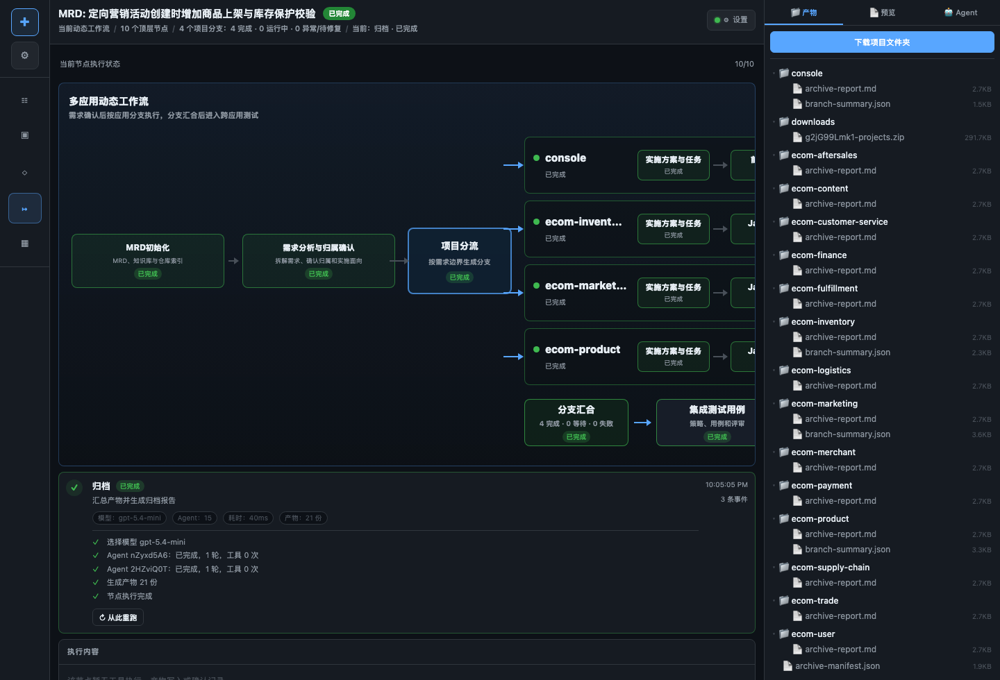
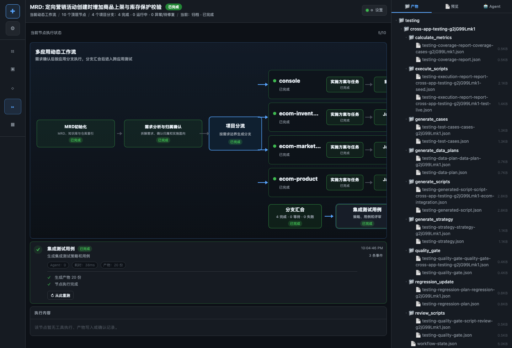
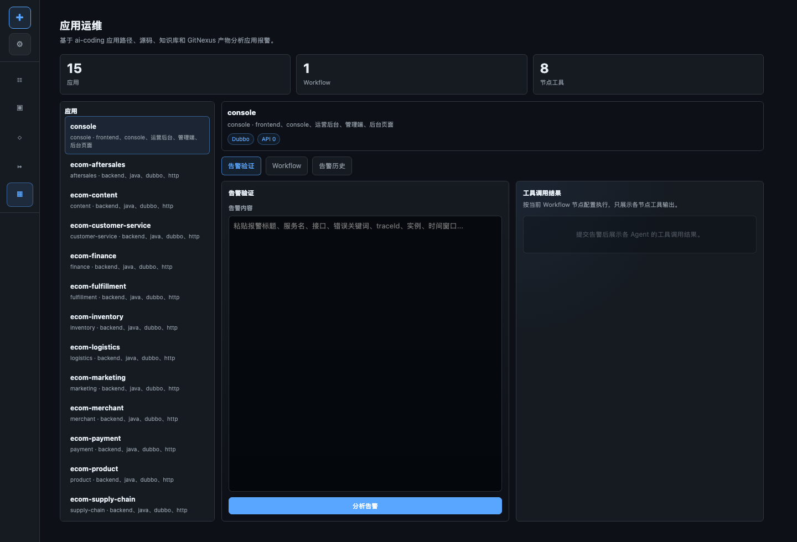

# AI Coding

AI Coding 是一个面向研发交付的 AI 工作台。它把 MRD、应用管理、知识库、需求 PI、代码生成、测试验证、应用运维和跨应用 AI Testing 串成一条可追踪的工作流。

当前产品形态不是“上传项目文件让模型猜”。需求从 MRD 和平台知识库出发，系统先基于应用管理列表、全局知识库和应用级知识库判断影响应用，再进入需求归属确认、应用分支并发实现、跨应用测试和归档交付。

## 产品截图

### AI Coding / 需求 PI



### AI Testing / 跨应用测试



### AI Ops / 应用运维



### 应用管理


### 知识库管理


## 产品演示与技术方案

每个模块都可以作为一个独立产品来介绍：先看产品演示和核心特色，再看技术链路和实现边界。

- [AI Coding 产品演示与技术方案](docs/ai-coding-technical-design.md)
- [AI Testing 产品演示与技术方案](docs/ai-testing-technical-design.md)
- [AI Ops 产品演示与技术方案](docs/ai-ops-technical-design.md)
- [应用管理产品演示与技术方案](docs/application-management-technical-design.md)
- [知识库管理产品演示与技术方案](docs/knowledge-management-technical-design.md)
- [GitNexus 与影响面分析产品演示与技术方案](docs/knowledge-gitnexus-impact-design.md)

## 核心能力

- 需求管理：维护 MRD，MRD Ready 后从需求管理页面启动 PI 流程。
- 应用管理：维护应用列表、仓库路径、应用类型、业务域、接口和依赖信息。
- 知识库管理：生成应用级知识库、全局应用能力图谱、依赖图谱、API 路由图和业务术语索引。
- 需求归属确认：根据 MRD + 全局知识库 + 应用级知识库确认影响应用，不依赖硬编码业务映射。
- 应用分支流水线：每个应用独立子 agent、独立状态、独立产物和独立失败回退。
- AI Coding：按应用生成实施方案与任务，完成 Java/前端实现、代码审查、后端测试、前端测试和分支摘要。
- AI Testing：生成集成测试用例、造数计划、集成测试代码，部署关联应用并执行真实跨应用测试。
- AI Ops：基于应用、源码、知识库、GitNexus 产物和本地告警内容做告警分析与修复建议。
- 生命周期产物：部署、测试、覆盖率、质量门禁、失败归因、回归计划和归档报告统一登记为 lifecycle artifacts。

## 已跑通的真实 Case

当前完整跑通的主用例是：

```text
MRD: 定向营销活动创建时增加商品上架与库存保护校验
```

系统根据 MRD 和知识库命中的影响应用：

- `console`
- `ecom-marketing`
- `ecom-product`
- `ecom-inventory`

已验证能力：

- 从需求管理启动 PI 流程。
- 需求分析与归属确认不再要求上传代码项目。
- 应用分支按流水线并发推进，而不是阶段栅栏式推进。
- 子 agent 之间隔离上下文，一个分支失败不会污染 sibling 分支。
- `console` 前端实现和测试独立执行。
- 后端应用完成 Java 实现和后端测试。
- 跨应用测试执行真实造数和真实集成测试。
- 最终归档完成。

真实跨应用测试仓库：

```text
demo/ecom/ecom-integration-tests
```

真实执行命令：

```bash
npm run seed
npm run test:live
```

已验证 run：

```text
g2jG99Lmk1
```

该 run 已完成全部 PI 节点，`npm run seed` 写入真实商品、库存、活动数据，`npm run test:live` 执行 `node:test` 集成测试并通过 2 个用例。

## 示例

### 需求输入示例

```text
定向营销活动创建时，需要校验商品是否已上架，并校验库存是否可用。
如果商品未上架或库存不足，活动创建应失败并给出明确提示。
```

### 应用归属示例

| 应用 | 归属原因 | 处理方式 |
| --- | --- | --- |
| `ecom-marketing` | 活动创建主流程 | 进入后端实现分支 |
| `ecom-product` | 商品上架状态校验 | 进入后端实现分支 |
| `ecom-inventory` | 库存保护校验 | 进入后端实现分支 |
| `console` | 活动创建页面提示和交互 | 进入前端实现分支 |

### AI Testing 示例

```text
造数：
  -> 创建 SALEABLE SKU
  -> 设置 AVAILABLE 库存
  -> 创建 DRAFT 定向活动

集成测试：
  -> 商品和库存数据准备完成后允许创建活动
  -> 未上架商品和低库存场景进入负向用例
```

### AI Ops 示例

```text
告警：营销活动创建失败率升高
线索：marketing createCampaign 接口返回库存保护错误
影响面：ecom-marketing -> ecom-product / ecom-inventory
建议：先校验商品状态接口，再校验库存查询链路，最后回归活动创建链路
```

## 工作流

### 需求 PI 主流程

```text
MRD / Knowledge Init
  -> 需求分析与归属确认
  -> 实施方案与任务
  -> 应用分支流水线
  -> 分支汇合
  -> 集成测试用例
  -> 造数
  -> 生成集成测试代码
  -> 部署关联应用
  -> 执行集成测试
  -> 归档
```

### 应用分支流水线

后端应用：

```text
implementation-plan
  -> java-impl
  -> backend-test
```

前端应用：

```text
implementation-plan
  -> frontend-impl
  -> frontend-test
```

### AI Testing 流程

```text
load_requirement
  -> retrieve_context
  -> generate_strategy
  -> review_strategy
  -> generate_cases
  -> review_cases
  -> generate_data_plans
  -> review_data_plans
  -> deploy_related_apps
  -> generate_scripts
  -> review_scripts
  -> execute_scripts
  -> collect_report
  -> calculate_metrics
  -> quality_gate
  -> failure_triage
  -> regression_update
  -> persist_artifacts
```

## 快速开始

### 环境要求

- Node.js 20+
- npm
- Java / JDK
- Maven
- 可用的大模型 API 配置

### 安装

```bash
npm install
npm run build
```

### 启动

```bash
npm start
```

默认访问：

```text
http://localhost:3000
```

开发模式：

```bash
npm run dev
```

### 模型配置

常用环境变量：

```bash
LLM_PROVIDER=openai-compat
LLM_MODEL=gpt-5.4
LLM_BASE_URL=https://your-model-endpoint/v1
LLM_API_KEY=your-api-key
JAVA_HOME=/path/to/jdk
MAVEN_HOME=/path/to/maven
PORT=3000
```

完整 PI 流程应使用真实大模型调用验证，不应使用 mock LLM。

## Demo Ecom

Demo 多应用工程位于：

```text
demo/ecom/
```

常用命令：

```bash
./demo/ecom/scripts/init-db.sh
./demo/ecom/scripts/build-all.sh
./demo/ecom/scripts/start-all.sh
./demo/ecom/scripts/stop-all.sh
```

集成测试仓库：

```text
demo/ecom/ecom-integration-tests/
```

它包含：

- 测试 fixture
- 各领域数据 builder
- `seed` 造数脚本
- `node:test` 集成测试
- live 服务健康检查

手动验证：

```bash
cd demo/ecom/ecom-integration-tests
npm run seed
npm run test:live
```

`test:live` 要求相关服务可用；服务不可用时会失败，不会静默 skip。

## 关键产物

运行态目录：

```text
runtime-projects/runs/<runId>/artifacts/
```

常见 PI 产物：

- `project-manifest.json`
- `mrd-clarified.md`
- `mrd-clarify-questions.md`
- `requirement-ownership.json`
- `fanout-decision.json`
- `<app>/tech-design.md`
- `<app>/openspec/.../tasks.md`
- `<app>/changed-files.json`
- `<app>/code-preview-manifest.json`
- `<app>/code-review.md`
- `<app>/changed-test-files/*`
- `<app>/test-report.md`
- `<app>/frontend-implementation-report.md`
- `<app>/frontend-test-report.md`
- `<app>/branch-summary.json`
- `cross-app/test-results.json`
- `cross-app/delivery-metadata.json`
- `archive-manifest.json`

AI Testing 产物：

- `testing/<workflowInstanceId>/generate_strategy/testing-strategy-*.json`
- `testing/<workflowInstanceId>/generate_cases/testing-test-cases-*.json`
- `testing/<workflowInstanceId>/generate_data_plans/testing-data-plan-*.json`
- `testing/<workflowInstanceId>/generate_scripts/testing-generated-script-*.json`
- `testing/<workflowInstanceId>/execute_scripts/testing-execution-report-*.json`
- `testing/<workflowInstanceId>/calculate_metrics/testing-coverage-report-*.json`
- `testing/<workflowInstanceId>/quality_gate/testing-quality-gate-*.json`
- `testing/<workflowInstanceId>/regression_update/testing-regression-plan-*.json`

## 架构分层

```text
src/
  agents/
    codegen/          # 需求 PI 与代码生成 Agent
    testing/          # AI Testing Agent
    ops/              # AI Ops Agent
    knowledge/        # 知识库 Agent
    core/             # 共享 Agent Runtime
  application/        # 应用管理产品服务
  knowledge/          # 知识库初始化与检索
  lifecycle/          # 部署、测试、归档、质量门禁等生命周期事实模型
  requirement-pi/     # 需求 PI 产品入口
  requirements/       # 需求管理服务
  testing/            # AI Testing 产品服务
  app-ops/            # 应用运维服务
  tools/
    builtin/          # read / grep / glob / edit / bash / Java / Maven 工具
    knowledge/        # 知识库检索工具
    testing/          # 造数、脚本、执行、指标、schema 工具
    ops/              # 运维分析工具
  workflows/
    definitions/      # Workflow 模板与节点契约
    engine/           # PI Pipeline Engine
    runtime/          # 分支执行、testing runtime、ops runtime
  server/             # Hono API、Controller、WebSocket
  session/            # Session 与 execution-state 读模型
web/                  # 单页前端
prompts/              # 节点 Prompt
demo/ecom/            # 本地多应用 Demo 工作区
```

分层原则：

- Controller 只做 HTTP 入口，不承载业务逻辑。
- 产品服务层负责需求、应用、知识库、测试、运维等领域能力。
- Workflow definition 描述流程模板，runtime/engine 负责执行。
- Agent 负责推理和工具调用，正式结果必须落结构化 artifact。
- Tool 负责读写文件、检索知识库、执行构建测试和运行真实命令。
- lifecycle 记录部署、测试、覆盖率、质量门禁、失败归因、归档等事实。

## 测试

运行全部测试：

```bash
npm test
```

常用聚焦测试：

```bash
npm run build
node --test dist/__tests__/workflow-foundation.test.js
node --test dist/__tests__/testing-workflow-runtime.test.js dist/__tests__/testing-controller.test.js dist/__tests__/testing-tools.test.js
```

## 运行说明

- 运行态保存在 `runtime-projects/`。
- 本地模型配置和密钥不应提交到 Git。
- 每个应用分支拥有独立 agent id、artifact index、失败状态和重试状态。
- 顶层 fanout/join 只汇总分支状态，不共享子 agent 上下文。
- 跨应用测试不能只看节点状态，必须查看真实 execution report。

## License

内部原型项目。公开发布前请补充正式 License。
