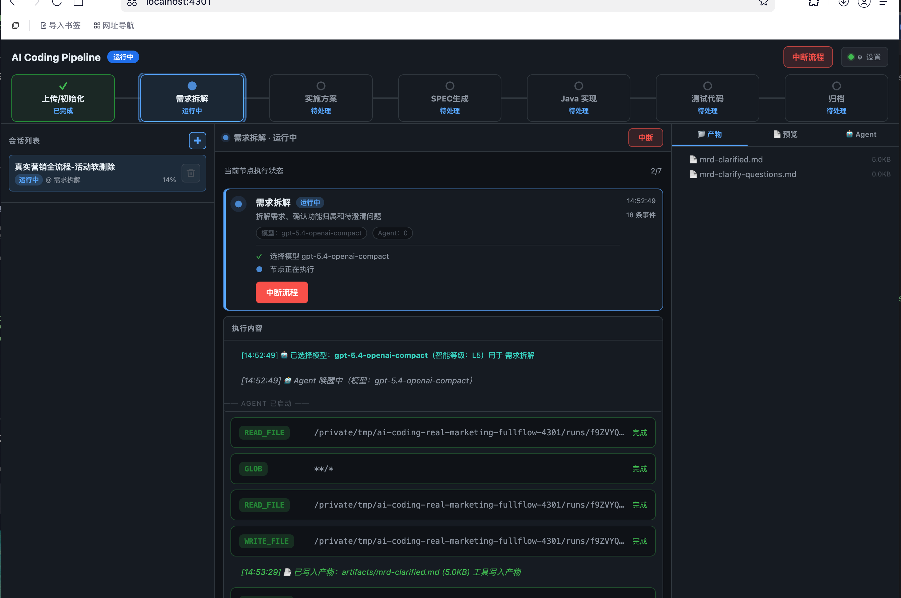
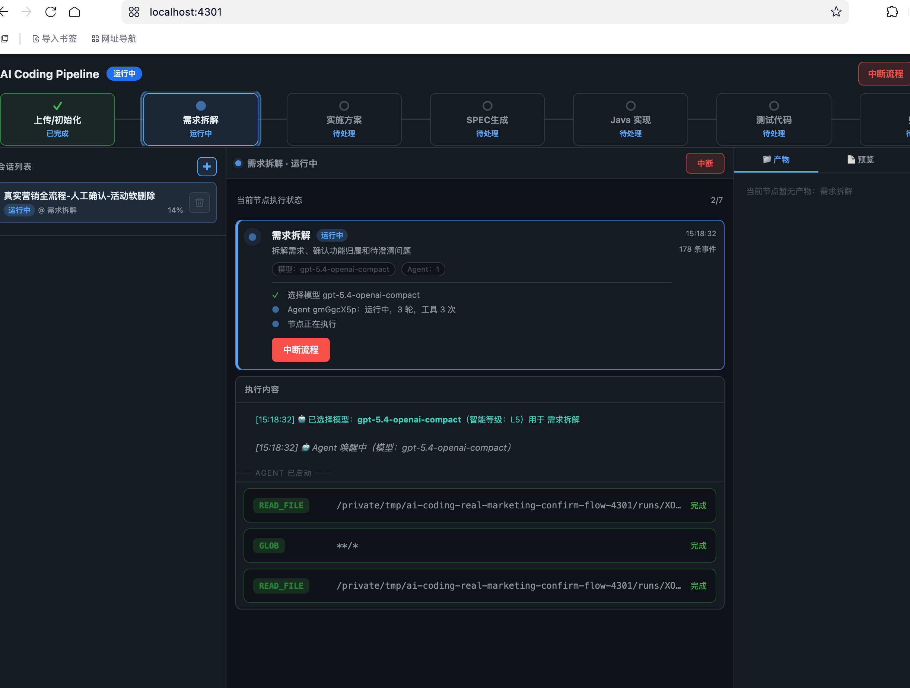
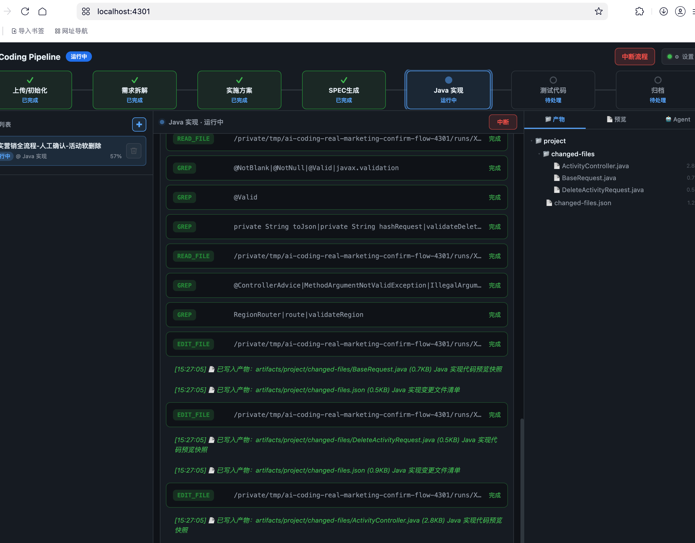
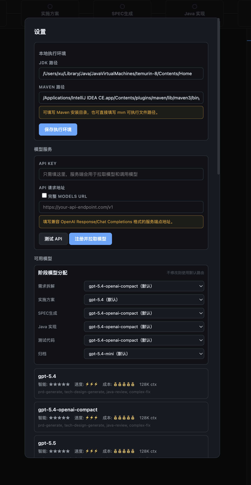
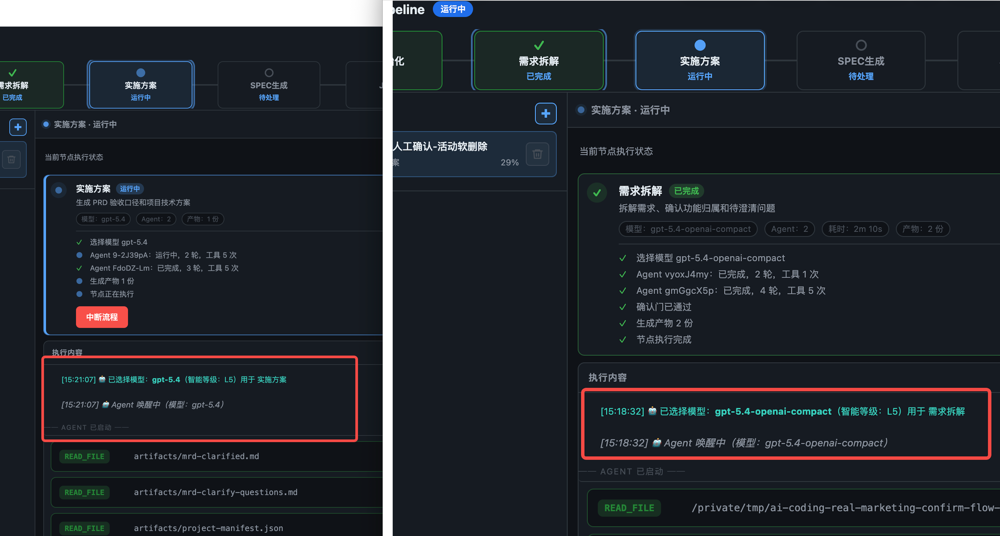
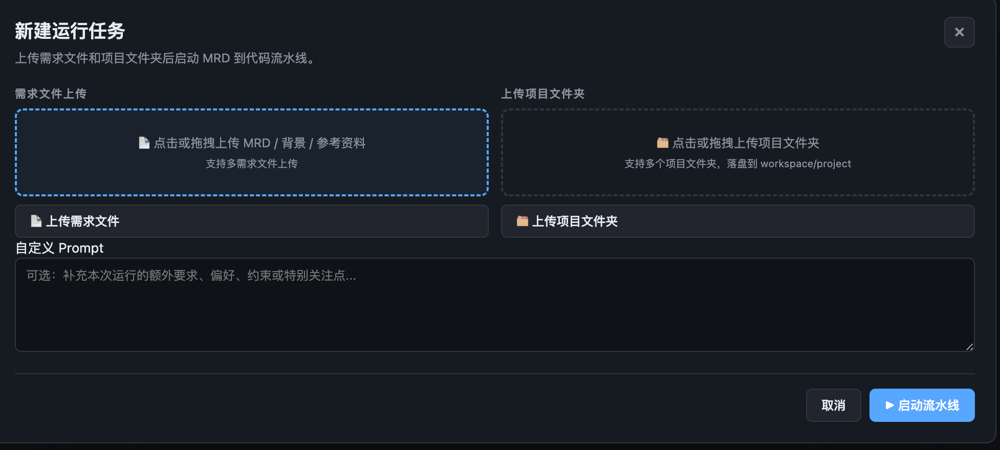
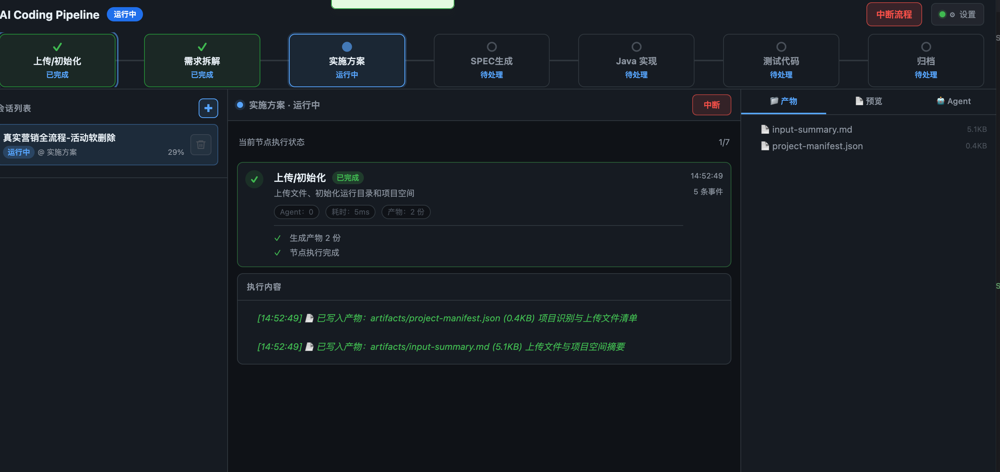
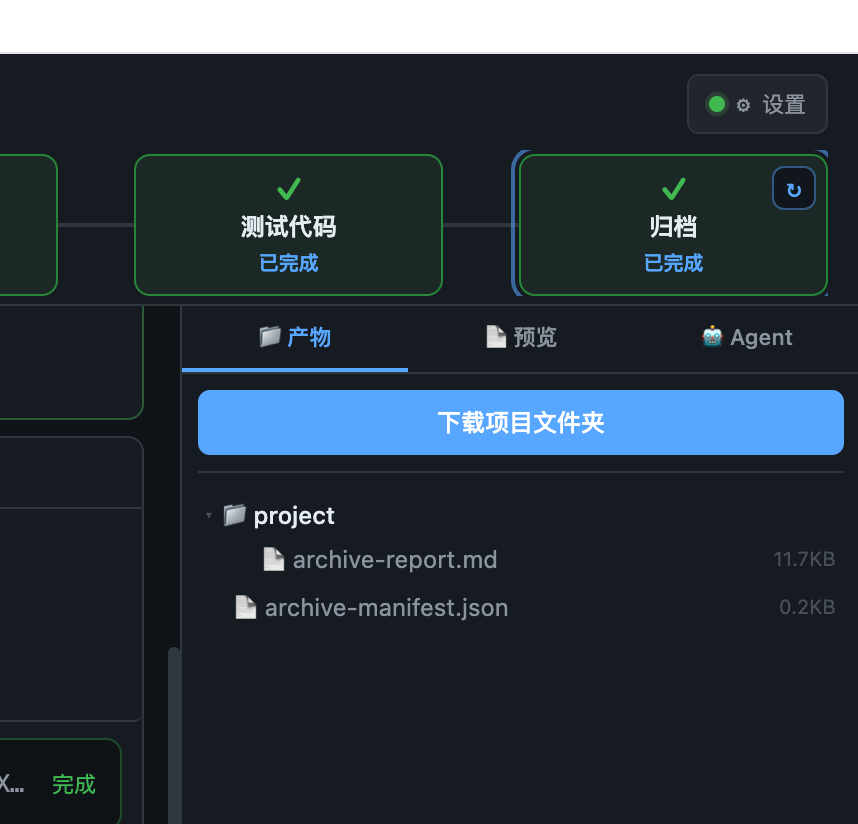
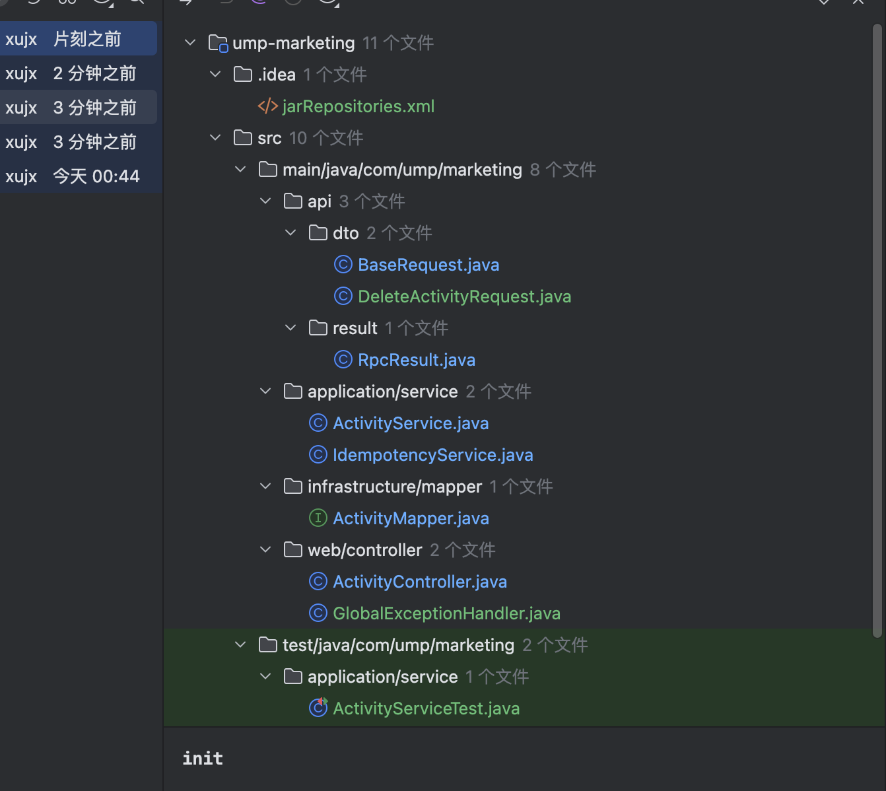
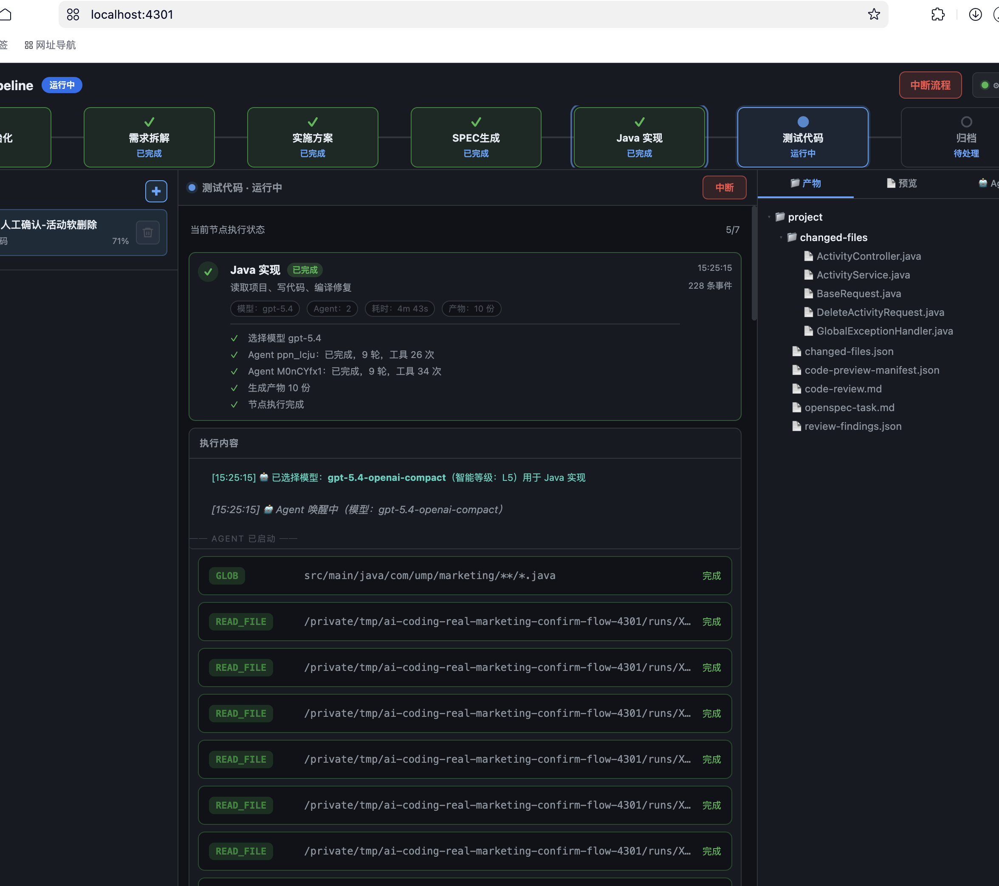

# AI Coding Pipeline

一个 Web 版 AI Coding 工作台：上传需求文档和 Java/Maven 项目后，系统按固定流水线完成需求拆解、实施方案、Spec 任务清单、Java 实现、测试代码生成、单元测试执行和归档交付。

项目内置了一个真实跑通的完整 Demo：营销项目“活动软删除”需求。服务启动后默认自动加载这个 Demo，新用户打开页面就能看到完整执行轨迹、工具调用、产物和最终归档。



## 文档导航

- [产品演示流程](docs/product-demo-flow.md)：面向演示和讲解，按截图串起完整产品链路。
- [架构设计](docs/architecture.md)：说明前端、服务端、流水线、Agent、工具和运行态存储的整体关系。
- [节点设计](docs/node-design.md)：说明每个固定节点的输入、执行方式、确认门和产物契约。
- [节点流转设计](docs/node-transition.md)：说明启动、确认、重跑、回退、自动重试和中断的状态流转。
- [上下文压缩设计](docs/context-compression.md)：说明 Agent 内部压缩和跨节点瘦上下文的边界。

## 核心能力

- 需求上传：支持上传 MRD/需求文件和项目源码目录。
- 需求拆解：读取需求与项目结构，生成 `mrd-clarified.md` 和 `mrd-clarify-questions.md`。
- 人工确认：需求拆解和实施方案支持确认门，用户可确认或反馈重跑。
- 实施方案：生成 `prd.md`、`implementation-plan-manifest.json` 和项目级 `tech-design.md`。
- Spec 任务清单：生成项目级 `openspec-task.md` 和 `openspec-test-task.md`。
- Java 实现与代码审查：同一节点内调用真实工具读写代码、编译、自审并产出变更清单和 review 报告。
- 测试代码与单元测试：同一节点内生成测试代码、执行 Maven 测试、分类失败并支持自动回退修复。
- 执行轨迹：中间区域持久化展示 Agent、工具调用、重试、回退、确认门和上下文压缩事件。
- 产物实时刷新：工具写入产物后，右侧产物区域可看到最新文件。
- 归档交付：生成项目归档报告和可下载项目包。

## 流水线

固定流程定义在 `src/pipeline/definition.ts`：

1. `Upload / Init`：初始化运行目录，处理上传需求与项目。
2. `需求拆解`：拆解需求、识别项目归属、生成澄清问题。
3. `实施方案`：生成 PRD 和项目级技术方案。
4. `SPEC生成`：生成开发任务清单和测试任务清单。
5. `Java Impl`：实现 Java 代码并执行代码审查。
6. `Test Code Generate`：生成测试代码并执行 Maven 单元测试。
7. `Archive`：汇总产物、执行指标、工具耗时和 token 消耗。





## 内置 Demo

默认启动时会自动克隆真实快照：

- 快照目录：`fixtures/full-flow-demo/run`
- 页面名称：`完整流程演示 Demo`
- 示例需求：营销活动软删除
- 示例项目：Spring Boot + MyBatis + Maven
- 示例结果：完成需求拆解、PRD、技术方案、Spec、Java 代码修改、测试代码、Maven 测试和归档报告

如果不希望启动时自动注入 Demo：

```bash
AI_CODING_AUTO_DEMO=0 npm start
```

Demo 会被克隆到运行态目录，不会直接修改 `fixtures/full-flow-demo/run`。

## 快速开始

### 环境要求

- Node.js 20+
- npm
- Java/JDK，执行 Java 实现和测试节点时使用
- Maven，执行编译和单元测试时使用

### 安装和启动

```bash
npm install
npm run build
npm start
```

默认访问：

```text
http://localhost:3000
```

开发模式：

```bash
npm run dev
```

常用环境变量：

```bash
PORT=4301
HOST=127.0.0.1
RUNTIME_DIR=/tmp/ai-coding-runtime
LLM_PROVIDER=openai-compat
LLM_MODEL=claude-sonnet-4-6
LLM_BASE_URL=https://your-model-endpoint/v1
LLM_API_KEY=your-api-key
JAVA_HOME=/path/to/jdk
MAVEN_HOME=/path/to/maven-or-mvn
```

也可以在页面“设置”里配置模型、JDK 路径和 Maven 路径。





## 使用方式

1. 打开页面，查看自动加载的 `完整流程演示 Demo`。
2. 点击“新建任务”，上传需求文档和项目源码。
3. 进入 `Upload / Init` 后查看上传内容。
4. 等待 `需求拆解` 完成，回答澄清问题并确认。
5. 查看并确认 `实施方案`。
6. 查看 `SPEC生成` 的开发/测试任务清单。
7. 观察 `Java Impl` 和 `Test Code Generate` 的工具调用轨迹。
8. 查看测试报告和归档报告。
9. 下载最终项目包。







## 运行态目录

默认运行态目录是：

```text
runtime-projects/
```

目录内包含每次运行的 workspace、artifacts、logs、agents 和 checkpoints。它属于运行时数据，已在 `.gitignore` 中忽略，不应提交到 Git。

本地模型配置和密钥保存在 `.ai-coding/`，同样不会进入 Git。

## 重要产物

典型运行会生成：

- `artifacts/input-summary.md`
- `artifacts/project-manifest.json`
- `artifacts/mrd-clarified.md`
- `artifacts/mrd-clarify-questions.md`
- `artifacts/prd.md`
- `artifacts/implementation-plan-manifest.json`
- `artifacts/<project>/tech-design.md`
- `artifacts/<project>/openspec-task.md`
- `artifacts/<project>/openspec-test-task.md`
- `artifacts/<project>/changed-files.json`
- `artifacts/<project>/code-preview-manifest.json`
- `artifacts/<project>/code-review.md`
- `artifacts/<project>/changed-test-files/*`
- `artifacts/<project>/test-report.md`
- `artifacts/<project>/archive-report.md`



## 工具与安全

Agent 可使用内置工具读取、搜索、编辑和写入项目文件，也可以调用 Java/Maven 工具执行编译与测试。工具执行范围限制在当前 run 的 workspace/project 和 artifacts 内。

关键工具包括：

- `read_file`
- `write_file`
- `edit_file`
- `glob`
- `grep`
- `bash`
- `maven_compile`
- `maven_test`
- `review_artifact`
- `skill`
- `discover_skills`

系统会记录工具开始、结束、失败、耗时和输出摘要，方便复盘。



## 测试

```bash
npm test
```

当前测试覆盖固定流水线 mock 闭环、需求拆解多文件输入、确认门恢复和大文件需求处理。

## 项目结构

```text
src/
  agent/              # Agent loop、上下文压缩、token 预算
  events/             # 事件类型和事件日志
  models/             # 模型注册和 provider
  persistence/        # execution-state、agent state 存储
  pipeline/           # 固定流水线、节点编排和 node agent
  runtime/            # run 目录、上传处理
  server/             # Hono HTTP API 和 WebSocket
  tools/              # 内置工具和安全校验
web/                  # 单页前端
prompts/              # 节点 prompt
prompts/template/     # 输出模板和兜底模板
fixtures/full-flow-demo/run/ # 真实完整流程 Demo 快照
docs/png/             # README 和演示文档截图
```

## 设计原则

- 主流程只负责状态流转、确认门、回退、重试和事件持久化。
- 业务 prompt 放在 `prompts/`，输出模板放在 `prompts/template/`。
- 下游节点优先读取正式产物和 context manifest，不把 Agent transcript 当作业务输入。
- Java 实现和测试节点必须通过工具真实读写项目文件。
- 回退和重试保留历史工具轨迹，便于用户确认每一轮发生了什么。

## 交流方式
  邮箱：153268908@qq.com 

