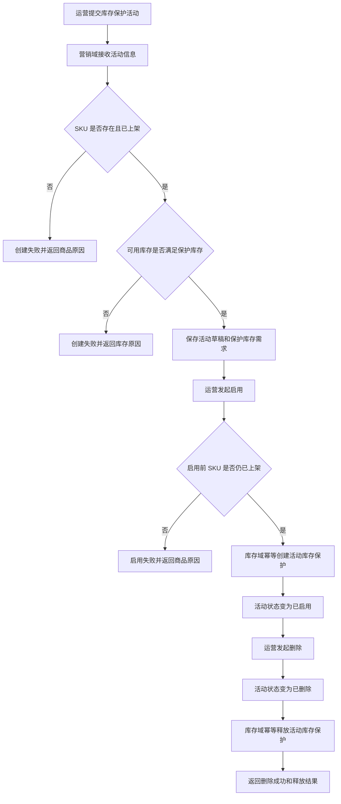

# 定向营销活动创建时增加商品上架与库存保护校验 PRD

## 一、背景

当前运营后台已经能完成商品上架、营销活动创建与启用、交易下单演示等动作，但营销活动在创建阶段只校验活动自身字段，没有校验关联 SKU 是否已上架，也没有校验活动预算所需库存是否可承接。

这会导致运营创建并启用活动后，用户在交易链路才发现商品未上架、库存不足或库存不可用。对秒杀、满减、定向券等库存敏感活动，问题会直接影响活动转化和运营信任。

本次需求在营销活动创建、启用、删除三个节点补齐商品与库存保护校验，并在运营后台展示清晰结果。创建阶段只做商品和库存校验，不立即保护库存；启用阶段才正式建立活动库存保护；删除阶段释放活动库存保护。

## 二、目标

1. 运营创建库存保护活动时，系统校验 SKU 是否存在且已上架。
2. 运营创建库存保护活动时，系统校验 SKU 可用库存是否满足活动保护库存预算。
3. 创建阶段只保存活动草稿和保护库存需求，不占用或保护库存。
4. 运营启用活动时，系统再次校验商品状态，并按活动维度幂等创建库存保护记录。
5. 运营删除活动时，系统释放活动库存保护；重复删除或重复释放返回成功，不造成库存重复增加。
6. 运营后台提供“创建受库存保护的活动”入口，展示商品、库存、活动三个域的处理结果和失败原因。

本期不改变交易下单扣减、支付、履约、物流等后续链路，这些链路仅作为回归观察范围。本期不引入 MQ，优先使用同步接口调用完成演示闭环。

## 三、角色 / 场景

| 角色 | 场景 | 业务价值 |
|------|------|----------|
| 运营 | 创建库存保护营销活动 | 创建前发现 SKU 未上架或库存不足，避免无效活动进入启用流程 |
| 运营 | 启用库存保护营销活动 | 启用前完成最终校验和活动库存保护，避免活动露出后无法承接 |
| 运营 | 删除库存保护营销活动 | 活动删除后释放保护库存，避免后续活动或交易被错误影响 |
| 测试 / 研发 | 回归交易演示链路 | 确认营销和库存新增规则不破坏既有下单、取消和释放流程 |

## 四、功能变更

| 编号 | 功能名称 | 功能描述 | 优先级 |
|------|----------|----------|--------|
| F1 | 库存保护活动创建入口 | 运营后台新增入口，提交活动 ID、名称、SKU、优惠金额、活动名额和保护库存数量 | P0 |
| F2 | 创建阶段商品校验 | 创建活动时校验 SKU 是否存在、是否已上架，并返回商品状态摘要 | P0 |
| F3 | 创建阶段库存校验 | 创建活动时校验可用库存是否不少于保护库存数量；只校验，不保护库存 | P0 |
| F4 | 活动启用保护库存 | 启用活动时再次校验 SKU 状态，并按活动和 SKU 维度幂等创建库存保护 | P0 |
| F5 | 活动删除释放保护 | 删除活动时释放对应库存保护；重复删除或释放返回幂等成功 | P0 |
| F6 | 结果展示 | 运营后台展示商品校验、库存校验、活动创建、启用和删除结果 | P1 |
| F7 | 交易链路回归 | 验证既有下单、取消、支付履约演示链路不受影响 | P1 |

## 五、业务规则

1. SKU 不存在时，库存保护活动创建失败，并提示 SKU 不存在。
2. SKU 存在但未上架时，库存保护活动创建失败，并提示 SKU 未上架。
3. 保护库存数量必须大于 0，且不能超过 SKU 当前可用库存。
4. 创建成功后活动处于草稿状态，记录保护库存需求，但不占用库存、不创建库存保护记录。
5. 启用活动前必须再次校验 SKU 是否仍然已上架。
6. 启用活动时，库存保护按活动 ID 和 SKU 维度幂等处理；同一活动重复启用不能重复保护库存。
7. 删除活动时，活动进入删除状态，并释放对应活动库存保护。
8. 活动已删除后再次删除，返回成功，并展示已经删除或已释放的结果。
9. 库存释放接口在保护记录不存在、已释放或重复释放时，都返回幂等成功。
10. 本期交易下单、扣减、取消释放仍沿用既有交易库存链路，不新增营销保护库存对交易扣减的拦截规则。

## 六、验收标准

| 编号 | 验收标准 |
|------|----------|
| AC1 | 当运营创建库存保护活动且 SKU 不存在时，创建失败，返回明确的 SKU 不存在原因 |
| AC2 | 当运营创建库存保护活动且 SKU 未上架时，创建失败，返回明确的 SKU 未上架原因 |
| AC3 | 当运营创建库存保护活动且可用库存不足时，创建失败，返回可用库存和保护库存差异 |
| AC4 | 当 SKU 已上架且库存充足时，创建成功，活动为草稿状态，且库存未被保护或占用 |
| AC5 | 当运营启用草稿活动时，系统再次校验 SKU 状态，并成功创建活动库存保护 |
| AC6 | 同一活动重复启用时，不重复创建保护记录，不重复减少可保护库存，返回成功或已保护结果 |
| AC7 | 删除已启用活动时，系统释放对应活动库存保护，并返回删除成功 |
| AC8 | 重复删除活动或重复释放保护库存时，返回幂等成功，不造成库存重复增加 |
| AC9 | 运营后台可以一键演示创建库存保护活动，并展示商品、库存、活动三个域的结果 |
| AC10 | 既有商品上架、普通营销活动创建、下单、取消、完整链路演示仍可正常执行 |

## 七、边界 / 待确认

1. 本期只支持单 SKU 活动库存保护，不覆盖多 SKU 组合活动。
2. 本期不引入异步消息、补偿任务或分布式事务，跨域调用失败时返回失败原因，由运营重试。
3. 本期新增活动库存保护表，不复用库存主表字段承载活动保护明细。
4. 本期创建阶段只做库存校验，不保护库存；活动启用才正式保护库存。
5. 本期不改变交易下单扣减规则，交易链路只做回归观察。
6. 保护库存是否参与真实交易可售库存扣减口径，后续如要上线真实生产能力需另行确认。

> **生成元数据**
> 工具：dev-workflow v0.1.0+codex.20260716131843 | Skill: implementation-plan v2.0.0
> 生成时间：2026-07-16
> 知识库快照：2026-07-16
