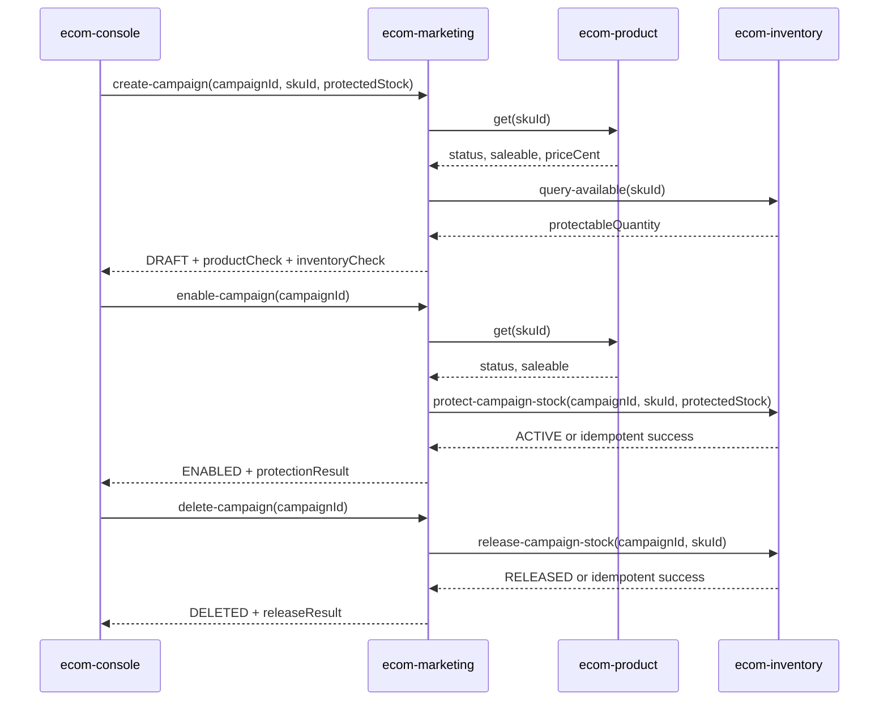

# 定向营销活动库存保护技术方案

## 一、需求概述

本需求为 ecom 领域新增“库存保护营销活动”闭环：运营后台发起创建，营销域编排商品和库存校验，商品域提供 SKU 售卖状态，库存域新增活动库存保护能力，交易域仅做回归观察。

澄清结论：

| 项目 | 结论 |
|------|------|
| 运营后台 | 使用 `/Users/xu/IdeaProjects/ecom/console`，登记为 `ecom-console` |
| 库存模型 | 新增活动库存保护表，不复用库存主表字段 |
| 创建阶段 | 只校验商品和库存，不保护库存 |
| 启用阶段 | 按 `campaignId + skuId` 幂等创建库存保护 |
| 删除阶段 | 重复删除和重复释放返回幂等成功 |
| 交易链路 | 不改交易生产代码，仅做回归验证 |

## 二、涉及应用（affected_apps，必填）

```json
{
  "affected_apps": [
    {
      "appId": "ecom-console",
      "repoPath": "/Users/xu/IdeaProjects/ecom/console",
      "role": "primary",
      "actions": ["code", "review", "test"],
      "responsibility": "新增创建库存保护活动入口，调用商品/库存/营销接口并展示校验与活动结果",
      "matchedTerms": ["运营后台", "库存保护活动"],
      "matchedFlows": ["campaign-stock-guard"],
      "evidence": "manual"
    },
    {
      "appId": "ecom-marketing",
      "repoPath": "/Users/xu/IdeaProjects/ai-coding/demo/ecom/ecom-marketing",
      "role": "primary",
      "actions": ["code", "review", "test"],
      "responsibility": "扩展活动创建/启用/删除能力，编排商品状态校验、库存校验、保护与释放，并返回结果摘要",
      "matchedTerms": ["营销活动", "活动预占"],
      "matchedFlows": ["campaign-stock-guard"],
      "evidence": "confirmed"
    },
    {
      "appId": "ecom-inventory",
      "repoPath": "/Users/xu/IdeaProjects/ai-coding/demo/ecom/ecom-inventory",
      "role": "secondary",
      "actions": ["code", "review", "test"],
      "responsibility": "新增活动库存保护表，提供可用库存查询、活动保护和幂等释放能力",
      "matchedTerms": ["库存", "库存预占"],
      "matchedFlows": ["campaign-stock-guard", "checkout-fulfillment"],
      "evidence": "confirmed"
    },
    {
      "appId": "ecom-product",
      "repoPath": "/Users/xu/IdeaProjects/ai-coding/demo/ecom/ecom-product",
      "role": "secondary",
      "actions": ["code", "review", "test"],
      "responsibility": "提供 SKU 售卖状态查询能力，返回 SKU 是否存在、是否上架和价格等摘要",
      "matchedTerms": ["商品"],
      "matchedFlows": ["catalog-publish", "campaign-stock-guard"],
      "evidence": "confirmed"
    },
    {
      "appId": "ecom-trade",
      "repoPath": "/Users/xu/IdeaProjects/ai-coding/demo/ecom/ecom-trade",
      "role": "verification",
      "actions": ["impact-check"],
      "responsibility": "交易演示链路保持不改代码，仅验证营销/库存变更不破坏下单与取消释放流程",
      "matchedTerms": ["订单", "交易编排"],
      "matchedFlows": ["checkout-fulfillment", "campaign-stock-guard"],
      "evidence": "confirmed"
    }
  ]
}
```

## 三、跨应用契约

| 类型 | 提供方 app | 消费方 app | 契约内容 | 兼容策略 | 证据等级 | 状态 |
|------|------------|------------|----------|----------|----------|------|
| HTTP | `ecom-product` | `ecom-marketing`, `ecom-console` | `POST /business/get`，入参 `id` 或 `skuId`，返回 `id`、`status`、`skuId`、`saleable`、`priceCent` | 保持既有字段，补齐缺失的查询入参兼容 | confirmed | confirmed |
| HTTP | `ecom-inventory` | `ecom-marketing`, `ecom-console` | 新增可用库存查询，入参 `skuId`，返回 `availableQuantity`、`campaignProtectedQuantity`、`protectableQuantity` | 新增接口，不破坏既有库存接口 | manual | open |
| HTTP | `ecom-inventory` | `ecom-marketing` | 新增活动库存保护，入参 `campaignId`、`skuId`、`protectedStock`，按 `campaignId + skuId` 幂等 | 重复保护返回已有保护记录，不重复扣减 | manual | open |
| HTTP | `ecom-inventory` | `ecom-marketing` | 新增活动库存释放，入参 `campaignId`、`skuId`，缺记录或已释放返回幂等成功 | 幂等成功，不重复增加可保护库存 | manual | open |
| HTTP | `ecom-marketing` | `ecom-console` | `POST /business/create-campaign` 扩展 `protectedStock`，创建时返回商品和库存校验摘要 | 对缺少 `protectedStock` 的普通活动保持兼容 | confirmed | open |
| HTTP | `ecom-marketing` | `ecom-console` | `POST /business/enable-campaign` 启用时触发库存保护并返回保护结果 | 保持原启用入口，扩展响应字段 | confirmed | open |
| HTTP | `ecom-marketing` | `ecom-console` | `POST /business/delete-campaign` 删除时释放活动保护，重复删除成功 | 保持原删除入口，扩展响应字段 | confirmed | open |
| DB | `ecom-inventory` | `ecom-inventory` | 新增 `inventory_campaign_protections` 表，唯一键 `campaign_id, sku_id` | 新表隔离，不改主库存表语义 | manual | open |
| Release | 全部涉及应用 | 全部涉及应用 | 发布顺序建议：商品、库存、营销、控制台 | 新接口先发布提供方，再发布编排方和控制台 | manual | open |

## 四、接口变更

### `ecom-product`

保留既有 `POST /business/get`。实现阶段需要确认入参是否只支持 `id`，如不支持 `skuId` 则兼容 `skuId`。响应应包含：

| 字段 | 类型 | 说明 |
|------|------|------|
| `id` | string | SKU ID |
| `status` | string | `SALEABLE` 表示已上架，`OFF_SHELF` 表示下架 |
| `skuId` | string | SKU ID |
| `saleable` | boolean | 创建时的可售标记 |
| `priceCent` | number | 基础价格 |

营销域判断可售时以 `status == SALEABLE` 为主，`saleable == true` 作为补充保护。

### `ecom-inventory`

建议新增三个 HTTP 能力：

| 接口 | 入参 | 出参 | 说明 |
|------|------|------|------|
| `POST /business/query-available` | `skuId` | `skuId`、`availableQuantity`、`campaignProtectedQuantity`、`protectableQuantity` | 创建阶段只读校验 |
| `POST /business/protect-campaign-stock` | `campaignId`、`skuId`、`protectedStock` | `campaignId`、`skuId`、`protectedStock`、`status`、`idempotent` | 启用阶段创建保护 |
| `POST /business/release-campaign-stock` | `campaignId`、`skuId` | `campaignId`、`skuId`、`status`、`idempotent` | 删除阶段释放保护 |

可用库存口径：

`protectableQuantity = inventory_stocks.available_quantity - sum(inventory_campaign_protections.protected_quantity where sku_id = ? and status = 'ACTIVE')`

### `ecom-marketing`

扩展既有接口，不新增营销入口：

| 接口 | 变更 |
|------|------|
| `POST /business/create-campaign` | 新增可选入参 `protectedStock`；有该字段时走库存保护活动创建校验；创建成功仍为 `DRAFT` |
| `POST /business/enable-campaign` | 对有 `protectedStock` 的活动启用时调用库存保护接口；保护成功后置为 `ENABLED` |
| `POST /business/delete-campaign` | 对有 `protectedStock` 的活动删除时调用库存释放接口；重复删除返回成功 |

### `ecom-console`

静态页面新增 `stockGuardCampaign` 操作，按顺序造数并展示结果：

1. 创建并上架演示 SKU。
2. 设置演示 SKU 库存。
3. 创建库存保护活动。
4. 启用库存保护活动。
5. 可选展示删除释放结果。

## 五、核心修改

### 商品域

`ecom-product` 已有 `BusinessService.get`、`enableSale`、`disableSale` 和 `product_skus` 表字段 `price_cent`、`saleable`、`status`。实现重点是确认 HTTP `/business/get` 能用 `skuId` 查询，并在响应中稳定返回 `status`、`saleable`、`priceCent`。

### 库存域

新增活动库存保护表：

| 字段 | 类型 | 说明 |
|------|------|------|
| `id` | VARCHAR(128) | 主键，可使用 `campaignId + ':' + skuId` |
| `campaign_id` | VARCHAR(64) | 活动 ID |
| `sku_id` | VARCHAR(255) | SKU ID |
| `protected_quantity` | INT | 保护库存数量 |
| `status` | VARCHAR(32) | `ACTIVE`、`RELEASED` |
| `payload_json` | JSON | 扩展信息 |
| `created_at` | TIMESTAMP | 创建时间 |
| `updated_at` | TIMESTAMP | 更新时间 |

唯一键：`campaign_id, sku_id`。保护库存时先计算可保护库存，库存不足返回失败；已有 `ACTIVE` 记录且数量一致返回幂等成功；已有 `RELEASED` 记录再次启用时可恢复为 `ACTIVE`，但必须重新校验可保护库存。释放时缺记录、已释放、重复释放都返回成功。

### 营销域

`marketing_campaigns` 建议新增或通过 `payload_json` 保存：

| 字段 | 说明 |
|------|------|
| `protectedStock` | 活动需要保护的库存数量 |
| `productCheck` | 创建或启用时商品校验摘要 |
| `inventoryCheck` | 创建时库存校验摘要 |
| `protectionResult` | 启用或删除时库存保护处理结果 |

若需要 JDBC 查询和列表稳定读取，建议新增 `protected_stock INT NULL` 列；演示优先可继续用 `payload_json` 保存扩展字段，但技术债需要在任务中标注。

创建流程：

1. 校验活动字段和 `protectedStock > 0`。
2. 查询商品域，SKU 不存在或未上架则失败。
3. 查询库存域可保护库存，不足则失败。
4. 保存活动为 `DRAFT`，记录保护库存需求和校验摘要。
5. 不调用库存保护接口。

启用流程：

1. 查询活动，若已 `ENABLED` 且保护已成功，返回幂等成功。
2. 再次查询商品域，SKU 不可售则失败。
3. 调用库存保护接口。
4. 保护成功后保存活动为 `ENABLED`。

删除流程：

1. 查询活动；若已 `DELETED`，仍尝试或直接返回已删除，释放结果按幂等成功展示。
2. 对有保护库存需求的活动调用库存释放接口。
3. 保存或保持 `DELETED` 状态。

## 六、时序图



## 七、影响分析

| 应用 | 影响 | 风险等级 | 证据 |
|------|------|----------|------|
| `ecom-console` | 新增静态按钮和请求编排，不影响既有按钮 | 中 | 手工登记并已建立 CodeGraph 索引 |
| `ecom-marketing` | 修改创建、启用、删除核心状态流转，新增跨域调用和幂等语义 | 高 | `BusinessService` 当前只做本地状态流转 |
| `ecom-inventory` | 新增保护表和三个库存保护接口，涉及库存一致性 | 高 | `inventory_stocks` 当前只有主库存和状态字段 |
| `ecom-product` | 查询接口兼容 `skuId` 并稳定返回可售字段 | 中 | 现有模型已有 `status`、`saleable`、`priceCent` |
| `ecom-trade` | 不改代码，执行下单、取消、完整链路回归 | 中 | 领域流 `checkout-fulfillment` 为库存相关回归面 |

CodeGraph 已在知识库登记并覆盖 demo 应用及 `ecom-console`。本方案阶段未调用专用 CodeGraph impact CLI，影响分析使用本地代码阅读、知识库 registry、API route map 和用户确认结果完成。

## 八、工时预估

| 工作项 | 应用 | 预估 |
|--------|------|------|
| 控制台新增库存保护活动入口和结果展示 | `ecom-console` | 0.75 人日 |
| 营销活动创建、启用、删除编排与幂等处理 | `ecom-marketing` | 1.25 人日 |
| 库存保护表、可用库存查询、保护和释放接口 | `ecom-inventory` | 1.25 人日 |
| 商品查询兼容和可售状态响应稳定化 | `ecom-product` | 0.50 人日 |
| 跨应用联调、造数、回归和文档校验 | 多应用 | 1.25 人日 |
| 合计 |  | 5.00 人日 |

复杂度分级：`full`。原因是预估 5 人日、跨 4 个改码应用、涉及库存和状态机、需要 OpenSpec 和跨应用契约固化。

## 九、测试要点

| 层级 | 测试点 |
|------|--------|
| 商品单元测试 | SKU 不存在、已上架、下架三类查询结果 |
| 库存单元测试 | 可保护库存计算、库存不足、重复保护、重复释放、缺记录释放 |
| 营销单元测试 | 创建只校验不保护、启用保护、重复启用、删除释放、重复删除 |
| HTTP 集成测试 | 商品、库存、营销接口字段和错误响应 |
| 控制台验证 | `stockGuardCampaign` 能展示商品、库存、活动结果 |
| 回归测试 | 既有商品上架、普通活动创建、交易下单、取消、完整链路演示 |

Stage 04 需要生成集成环境测试用例、造数方案、seed SQL 和 cleanup SQL。seed 数据建议包含：已上架 SKU、未上架 SKU、库存充足记录、库存不足记录、已启用保护活动、已释放保护记录。cleanup 应删除对应 SKU、库存、活动和保护表记录。

## 十、风险评估

| 风险 | 等级 | 应对措施 |
|------|------|----------|
| 创建阶段误保护库存 | 高 | 明确创建只调用库存查询接口，单元测试断言无保护记录 |
| 重复启用导致重复保护 | 高 | 库存保护表唯一键 `campaign_id, sku_id`，接口返回幂等成功 |
| 重复释放导致库存错误增加 | 高 | 释放只更新保护记录状态，不直接增加主库存；已释放返回成功 |
| 营销启用成功但库存保护失败 | 高 | 先保护成功再更新活动为 `ENABLED`，失败保持草稿或原状态 |
| 商品状态在创建后变化 | 中 | 启用阶段再次查询商品状态 |
| 控制台跨端口请求失败 | 中 | 保持 CORS 响应头，控制台显示每一步错误详情 |

## 十一、备注

1. 本阶段只生成实施方案和 OpenSpec 输入，不修改生产代码。
2. 由于本地仓库不存在 `validate-stage02-gates.js`，校验采用本地等价规则执行，并在执行状态中记录 fallback。
3. 飞书上传与回读在当前本地环境不可用，本地文件作为确认版来源。

## 附录I

需求拆解：

| 编号 | 任务 | 输出 |
|------|------|------|
| T1 | 控制台新增库存保护活动操作 | `app.js`、`index.html`、`style.css` |
| T2 | 商品查询兼容和测试 | 商品接口与测试 |
| T3 | 库存保护表和库存保护接口 | 库存服务、仓储、测试 |
| T4 | 营销编排和幂等状态流转 | 营销服务、仓储、测试 |
| T5 | 跨应用联调和回归 | OpenSpec 测试和执行记录 |

## 附录II

变更影响分析：

| 证据来源 | 结论 |
|----------|------|
| `spaces/knowledge/knowledge-base/domains/ecom/flows.md` | `campaign-stock-guard` 为核心新增流程，关联营销、商品、库存和交易回归 |
| `spaces/knowledge/knowledge-base/global/api-route-map.json` | 商品、库存、营销已有 HTTP 路由，可扩展业务接口 |
| `spaces/knowledge/knowledge-base/registry/apps.json` | affected apps 均已登记，`ecom-console` 为人工补充并已登记 |
| 本地代码阅读 | 营销和库存当前均为简单状态流转，需要新增库存保护语义 |

专用 CodeGraph impact 命令未在当前仓库提供，使用已生成的 `.codegraph` 索引登记、知识库路由图和代码阅读作为 fallback。

## 附录III

场景扩展分析：

| 场景 | 本期处理 | 后续扩展 |
|------|----------|----------|
| 多 SKU 活动 | 不支持 | 增加活动明细表和批量保护接口 |
| 活动保护库存参与真实可售扣减 | 不改变交易链路 | 统一库存可售口径后再接入交易 |
| 异步补偿 | 不引入 | 可增加 MQ 和补偿任务 |
| 活动恢复 | 不支持 | 增加 `DELETED` 到 `DRAFT` 的恢复规则 |

## 附录IV

多视角架构分析：

| 视角 | 分析 |
|------|------|
| 产品视角 | 运营在创建和启用两个关键节点获得可解释反馈 |
| 数据视角 | 活动保护与主库存隔离，避免字段复用造成语义混乱 |
| 一致性视角 | 不使用分布式事务，采用同步编排和幂等接口降低重复操作风险 |
| 发布视角 | 先发布商品和库存提供方，再发布营销编排和控制台入口 |
| 测试视角 | 高风险点集中在库存保护幂等、营销状态流转和既有交易回归 |
