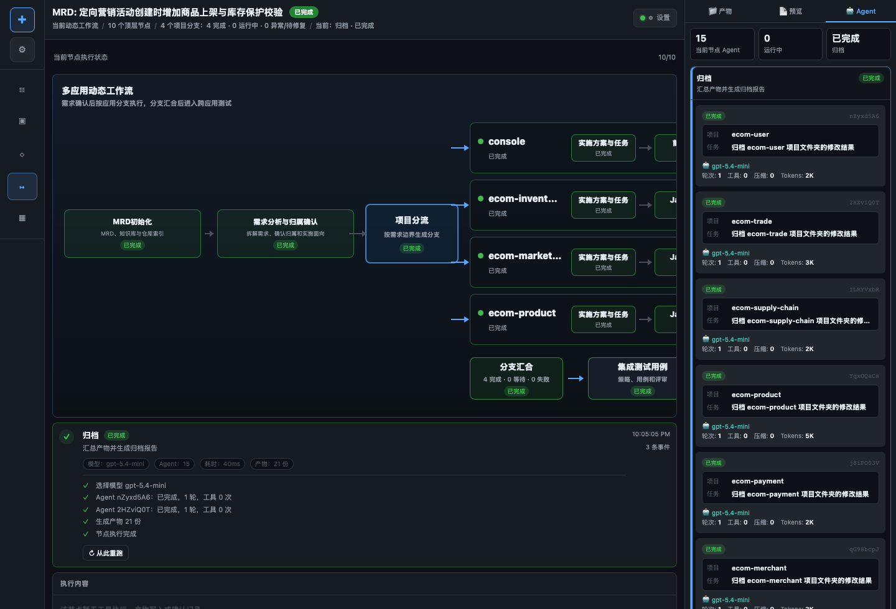
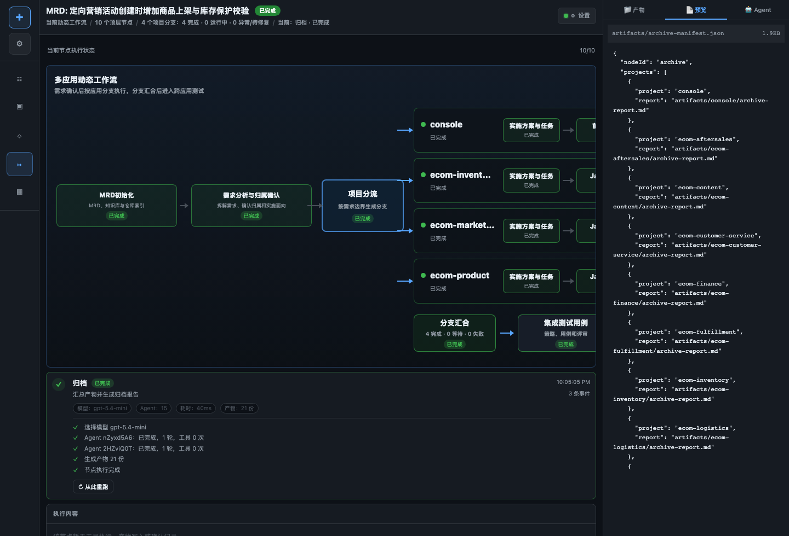

# AI Coding 产品演示与技术方案

AI Coding 负责从已确认的 MRD 进入需求 PI，并把需求拆到具体应用分支上完成实现、验证和归档。它不是一个单次代码生成器，而是围绕需求交付生命周期组织的多 Agent 工作流。

## 产品特色

- 从 MRD 和知识库启动，不要求用户上传项目文件。
- 把需求归属确认、实施方案、代码实现、测试验证、跨应用测试和归档放在同一条可视化流程里。
- 多应用分支按流水线并发推进，不是所有应用卡在同一个阶段栅栏。
- 每个应用分支都有独立子 agent、独立产物、独立失败回退。
- 页面可以按节点、应用和产物查看执行轨迹。

## 演示路径

1. 打开需求管理，选择 `MRD: 定向营销活动创建时增加商品上架与库存保护校验`。
2. 点击启动 PI 流程。
3. 查看“需求分析与归属确认”，确认系统从知识库命中 `console`、`ecom-marketing`、`ecom-product`、`ecom-inventory`。
4. 查看项目分流后的分支流水线。
5. 展开每个分支的 Agent 轨迹和产物。
6. 等待分支汇合后进入 AI Testing 和归档。

## 示例

### 输入 MRD

```text
定向营销活动创建时，需要增加商品上架校验和库存保护校验。
商品未上架、库存不可用或库存不足时，活动创建应失败。
运营后台需要展示明确错误提示。
```

### 知识库命中

```text
营销活动创建 -> ecom-marketing
商品上架状态 -> ecom-product
库存可用性 -> ecom-inventory
运营后台创建页面 -> console
```

### 分支结果

| 分支 | 节点 | 示例产物 |
| --- | --- | --- |
| `ecom-marketing` | `java-impl` / `backend-test` | `changed-files.json`、`test-report.md` |
| `ecom-product` | `java-impl` / `backend-test` | `code-review.md`、`surefire-summary.json` |
| `ecom-inventory` | `java-impl` / `backend-test` | `branch-summary.json` |
| `console` | `frontend-impl` / `frontend-test` | `frontend-implementation-report.md` |

### 典型输出

```text
fanout-decision.json
  includedProjects:
    - console
    - ecom-marketing
    - ecom-product
    - ecom-inventory

archive-manifest.json
  projects:
    - console
    - ecom-marketing
    - ecom-product
    - ecom-inventory
```

## 目标

- 根据 MRD、应用管理列表和知识库证据判断影响应用。
- 合并“需求归属确认、需求拆解、实施方案与任务”流程，减少重复确认。
- 按应用拆分并发分支，每个分支独立上下文、独立产物、独立失败回退。
- 支持后端、前端、测试等不同能力路径。
- 把代码变更、测试结果、代码审查、归档报告登记为结构化产物。

## 产品定位

AI Coding 是“需求到代码交付”的产品，不是单点代码补全能力。它面向研发负责人、开发工程师和测试负责人，解决跨应用需求从评审到落地时的信息断层：

- MRD 阶段不知道影响哪些应用。
- 技术方案阶段容易遗漏上下游。
- 多应用开发时状态不可见。
- 单应用测试通过不代表跨应用链路可发布。
- 产物散落在聊天记录、代码仓库和临时文件里，难以追踪。

AI Coding 把这些步骤变成一个可视化 workflow，并把每个 Agent 的产物写入运行态目录和 lifecycle。

## 页面视角

### 动态 PI 工作流


### Agent 轨迹



### 产物预览



## 入口链路

```text
需求管理
  -> MRD Ready
  -> 启动 PI 流程
  -> MRD / Knowledge Init
  -> 需求分析与归属确认
  -> 实施方案与任务
  -> 应用分支流水线
  -> 分支汇合
  -> AI Testing
  -> 归档
```

需求 PI 不再要求用户上传代码项目。候选应用来自应用管理和知识库：

```text
MRD
  -> 应用管理列表
  -> global 知识库召回
  -> 应用级知识库验证
  -> fanout-decision.json
  -> workflowInstance.branches
```

## 关键模块

```text
src/requirements/                 # 需求管理
src/application/                  # 应用管理
src/knowledge/                    # 知识库初始化与检索
src/agents/codegen/               # MRD 归属、实施方案、代码生成 Agent
src/workflows/engine/             # PI Pipeline Engine
src/workflows/sessionInstance.ts  # workflowInstance 读模型
src/workflows/fanoutDecision.ts   # 项目分流决策
src/workflows/requirementOwnership.ts
```

## 分支流水线

每个应用分支有独立节点状态和 agent 列表：

```text
branch(console)
  -> implementation-plan
  -> frontend-impl
  -> frontend-test

branch(ecom-marketing)
  -> implementation-plan
  -> java-impl
  -> backend-test
```

实现重点：

- `java-impl` 不再作为阶段栅栏统一等待所有应用。
- 分支内部可以按自己的进度进入下一个节点。
- 子 agent 以 `projectName + nodeId` 绑定到分支节点。
- 顶层 join 只汇总分支，不共享子 agent 上下文。
- 单分支失败只回退该分支，不覆盖 sibling 分支完成态。

## 状态模型

每个 run 会保存一份 `execution-state.json`，其中包含：

- 顶层节点状态。
- 当前节点。
- 项目分支状态。
- `workflowInstance` 动态读模型。
- 分支节点产物索引。
- 子 agent id。
- rollback / retry 状态。

`workflowInstance` 是前端渲染动态流程的核心，不修改全局 workflow template。它记录本次需求的真实拓扑：

```text
workflow template
  -> run workflowInstance
  -> fanout branches
  -> branch nodes
  -> join
```

## Agent 隔离

子 agent 隔离原则：

- 每个应用分支独立创建 `AgentEngine`。
- 子 agent 绑定 `projectName + nodeId`。
- 分支节点只显示本项目 agent。
- 顶层节点不把 childAgentIds 横向复制到所有分支。
- 旧进程中断后，running-like agent 会恢复为 suspended，避免页面误判。

这解决了多应用并发时“前一个分支上下文污染后一个分支”的问题。

## 回退策略

AI Coding 支持分支级回退：

- Java review BLOCK：只回退对应应用的 `java-impl`。
- 后端测试失败：根据失败分类回退实现或测试。
- 前端测试失败：回到对应应用的 `frontend-impl`。
- sibling 分支不回退、不重跑、不丢产物。

## 人工确认门与自动化边界

MVP 固定保留三类人工确认门：

```text
1. 需求归属 / 澄清确认
2. 技术方案确认
3. 测试环境发布前代码审核
```

其他环节默认自动推进，只有触发高风险条件时才插入异常确认门：

- 高风险命令。
- 大范围代码变更。
- 共享环境部署。
- 数据变更或造数。
- 权限升级。
- 失败归因不确定。

这样避免两个极端：每一步都人工确认导致自动化价值低，或者全程无确认导致代码、数据和环境风险不可控。

## 分支、提交与发布策略

多应用需求按应用拆分工作分支：

```text
feature/<requirementId>/<appId>
```

核心策略：

```text
一个需求 + 一个应用 = 一个工作分支
AI 先在本地 workspace 修改代码
代码审核通过后才允许触发 CI / 测试环境部署
集成环境以 branch / build artifact / deploymentSet 为主线
commitSha 只作为可选 sourceSnapshot
```

代码生成阶段至少产出：

- `changed-files.json`
- `code-preview-manifest.json`
- `code-review.md`
- `test-report.md`
- `branch-summary.json`

## 生命周期状态机

AI Coding 是唯一生命周期状态写入者。AI Testing、AI Ops、Harness Runtime 只返回结构化结果，由 AI Coding 写入统一状态。

核心对象：

```text
LifecycleState
  -> 当前需求事实快照

WorkflowRun
  -> 某次 workflow 执行记录

NodeRun
  -> 单个节点执行状态和可恢复依据

ArtifactRef
  -> 所有产物引用

EventLog
  -> 追加式历史事件
```

统一 ID：

- `requirementId`
- `runId`
- `appId`
- `branchName`
- `deploymentSetId`
- `pipelineRunId`
- `environmentId`
- `testRunId`
- `diagnosisId`
- `artifactId`
- `traceId`

## 失败归因与修复回流

失败归因由 AI Ops 能力承担，AI Coding 负责消费归因结果并推进后续 workflow。

默认分类：

```text
CODE_BUG
TEST_SCRIPT_BUG
DATA_SETUP_FAILED
ENVIRONMENT_NOT_READY
DEPENDENCY_UNAVAILABLE
CONFIG_ERROR
CI_INFRA_FAILURE
DOCKER_RESOURCE_FAILURE
UNKNOWN
```

处理策略：

- `CODE_BUG` 且置信度足够：回流 AI Coding 修代码。
- `TEST_SCRIPT_BUG`：回流 AI Testing 修脚本或断言。
- `DATA_SETUP_FAILED`：回流 AI Testing 修造数计划。
- `ENVIRONMENT_NOT_READY`：等待或重建环境。
- `UNKNOWN`：进入人工确认。

## MVP 验收链路

MVP 的验收目标是一条完整、可追踪、可恢复、可诊断、可归档的需求生命周期：

```text
MRD
  -> fanout 命中多个应用
  -> 至少一个应用产生代码变更
  -> 单应用测试
  -> 测试环境部署
  -> DataPlan 造数
  -> 集成测试执行
  -> 失败归因 / 修复回流
  -> 重测通过
  -> 归档
  -> 知识库增量更新
```

## 关键产物

- `mrd-clarified.md`
- `mrd-clarify-questions.md`
- `requirement-ownership.json`
- `fanout-decision.json`
- `<app>/tech-design.md`
- `<app>/openspec/.../tasks.md`
- `<app>/changed-files.json`
- `<app>/code-preview-manifest.json`
- `<app>/code-review.md`
- `<app>/test-report.md`
- `<app>/frontend-test-report.md`
- `<app>/branch-summary.json`
- `archive-manifest.json`

## 与知识库和影响面分析的关系

AI Coding 的影响面判断不写死业务别名，而是优先使用知识库：

1. 使用 MRD 关键词、业务域、验收场景召回 global 知识库。
2. 从 `app-domain-map`、`capability-map`、`api-route-map`、`dependency-map` 找候选应用。
3. 再读取候选应用的应用级知识库，验证是否真正拥有相关能力。
4. 把不确定项放入需求归属确认，不直接放大到全量应用。
5. 只有 MRD 和知识库都证明需要改代码的应用才进入实现分支。

## 截图


