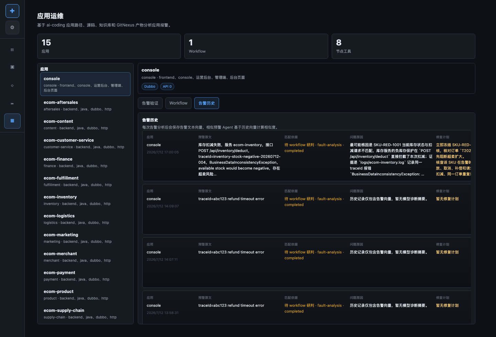

# AI Ops 产品演示与技术方案

AI Ops 负责应用运维告警分析。它面向应用列表、源码、知识库、GitNexus 图谱和本地告警内容，给出影响面、根因线索和修复建议。

## 产品特色

- 从应用管理列表选择告警所属应用。
- 告警分析不只看日志，还结合应用知识库和 GitNexus 影响面。
- 输出直接影响应用、上下游风险、排查顺序和修复建议。
- 可以作为后续 AI Coding 修复需求的入口。
- 适合值班排障、告警复盘和回归范围判断。

## 演示路径

1. 进入 AI Ops / 应用运维页面。
2. 选择告警所属应用，例如 `console` 或 `ecom-marketing`。
3. 输入告警标题、接口、traceId、错误关键词或日志片段。
4. 查看 Workflow 和工具调用结果。
5. 查看告警历史，复盘分析结论。

## 示例

### 告警输入示例

```text
标题：营销活动创建失败率升高
应用：ecom-marketing
接口：POST /marketing/campaigns
错误：STOCK_GUARD_REJECTED
traceId：trace-campaign-stock-guard-001
```

### 影响面输出示例

| 类型 | 结果 |
| --- | --- |
| 直接应用 | `ecom-marketing` |
| 上游入口 | `console` 活动创建页面 |
| 下游依赖 | `ecom-product`、`ecom-inventory` |
| 业务能力 | 定向营销活动创建、商品上架校验、库存保护 |
| 推荐动作 | 检查商品状态接口、库存查询接口、活动创建参数映射 |

### 修复建议示例

```text
1. 先确认 ecom-product 返回的 sku status 是否为 SALEABLE。
2. 再确认 ecom-inventory 返回的 availableQuantity 是否满足活动锁定量。
3. 如果两个下游正常，检查 ecom-marketing 的错误映射和 console 的错误展示。
4. 修复后需要重跑 AI Testing 的 targeted-campaign-stock-guard 集成测试。
```

## 目标

- 从应用管理选择告警所属应用。
- 根据告警文本、traceId、接口、异常关键词检索代码、日志和知识库。
- 使用 GitNexus 和应用知识库判断影响面。
- 给出可执行的定位步骤和修复建议。
- 后续可以与 AI Coding 打通，直接生成修复分支。

## 产品定位

AI Ops 是“告警到影响面和修复建议”的产品。它不是普通日志搜索框，而是把应用管理、知识库、GitNexus 和本地日志证据放到同一个分析工作台。

典型用户：

- 值班研发：需要快速判断告警是否影响核心链路。
- 应用负责人：需要知道上下游风险。
- 研发负责人：需要决定是否进入修复需求和回归测试。

## 页面视角

### 告警分析工作台


### Workflow 视角


### 告警历史



## 工作区能力

```text
应用选择
  -> 告警输入
  -> 本地日志 / Trace 检索
  -> 应用知识库证据
  -> GitNexus 影响面证据
  -> Agent 分析
  -> 修复建议
```

## 关键模块

```text
src/app-ops/                 # 应用运维产品服务
src/agents/ops/              # 运维分析 Agent
src/tools/ops/               # 日志、trace、告警分析工具
src/workflows/runtime/ops/   # 运维 runtime
demo/ecom/spaces/ops/        # demo 告警历史与运维数据
```

## 影响面分析

AI Ops 的影响面不是只看一条日志，而是综合多类证据：

1. 应用管理：告警属于哪个应用、应用业务域是什么。
2. 应用知识库：该应用的接口、核心能力、数据库表、依赖服务。
3. GitNexus：调用链、文件依赖、接口路由和上下游关系。
4. 本地日志：错误关键词、traceId、接口路径、异常堆栈。
5. 需求归档知识：历史需求是否改过同一能力。

输出应包含：

- 直接受影响应用。
- 可能受影响的上下游应用。
- 关联接口或业务能力。
- 推荐排查顺序。
- 修复建议和风险提示。

## Agent 链路

```text
alert input
  -> local_log_search
  -> knowledge evidence
  -> GitNexus impact evidence
  -> repair plan agent
  -> ops report
```

AI Ops 要求真实模型调用。mock LLM 下不应验证告警分析能力，因为告警分析依赖模型综合多源证据。

## 与 AI Coding / AI Testing 的关系

- AI Ops 可以把告警影响面转成修复需求，进入 AI Coding。
- 修复后的应用分支仍走独立实现和测试。
- 如果影响跨应用链路，后续进入 AI Testing 的集成测试和回归测试。

## 截图


