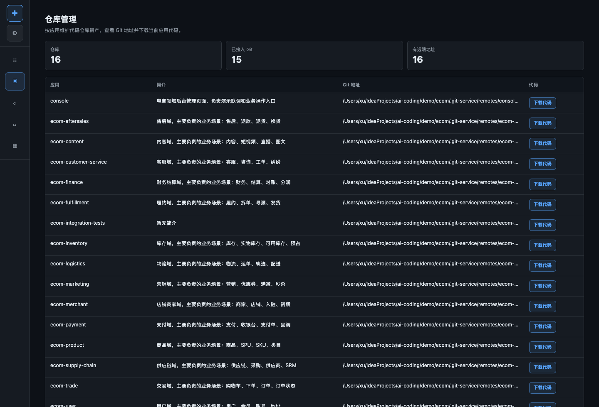

# GitNexus 与影响面分析产品演示与技术方案

GitNexus 与知识库共同构成 AI Coding、AI Testing、AI Ops 的影响面分析底座。知识库偏业务解释，GitNexus 偏代码结构和依赖证据。它们解决的问题是：模型不能只靠 MRD 文本或硬编码规则判断影响应用，必须有稳定、可追溯的事实证据。

## 产品特色

- 面向“影响面分析”这个横切能力，不归属于单个页面。
- 同时服务 AI Coding、AI Testing、AI Ops。
- 把业务知识库和代码图谱结合起来。
- 输出应用、接口、依赖、测试范围和告警上下游风险。

## 演示路径

1. 在知识库管理中查看全局知识库和应用知识库。
2. 在需求 PI 中查看需求归属确认和 fanout decision。
3. 在 AI Testing 中查看跨应用测试范围。
4. 在 AI Ops 中查看告警影响面分析。

## 示例

### 需求影响面示例

```text
MRD: 定向营销活动创建时增加商品上架与库存保护校验

业务术语：
  - 定向营销活动
  - 商品上架
  - 库存保护

影响面：
  - ecom-marketing: 活动创建主链路
  - ecom-product: 商品状态判断
  - ecom-inventory: 库存可用性判断
  - console: 用户操作入口和错误提示
```

### GitNexus 证据示例

```text
接口链路：
  console -> ecom-marketing.createCampaign
  ecom-marketing -> ecom-product.getSku
  ecom-marketing -> ecom-inventory.getStock

测试链路：
  targeted-campaign-stock-guard
    -> seed product
    -> seed inventory
    -> create campaign
    -> assert campaign status
```

### Ops 影响面示例

```text
告警接口：POST /marketing/campaigns
错误关键词：STOCK_GUARD_REJECTED

影响面推断：
  1. 直接故障：ecom-marketing
  2. 依赖风险：ecom-product / ecom-inventory
  3. 用户入口：console
  4. 回归建议：重跑 AI Testing targeted-campaign-stock-guard
```

## 目标

- 使用 GitNexus 补充代码结构、调用关系、文件依赖和图谱证据。
- 支撑需求归属确认、跨应用测试范围、运维告警影响面分析。
- 为知识库中的业务判断提供代码级证据。

## GitNexus 的作用

GitNexus 更偏代码图谱，它为知识库提供结构化证据：

- 文件与模块关系
- 接口和路由入口
- 调用关系
- 依赖方向
- 代码热点
- 变更影响路径

## 影响面分析定位

影响面分析不是一个独立页面，而是一组被 AI Coding、AI Testing、AI Ops 复用的底层能力：

```text
业务事实：知识库
代码事实：GitNexus
运行事实：lifecycle artifacts
需求事实：MRD / requirement ownership
告警事实：ops alert / logs / trace
```

不同产品使用同一套事实，但关注点不同：

- AI Coding 关注“哪些应用要改”。
- AI Testing 关注“哪些链路要测”。
- AI Ops 关注“哪些上下游受影响”。

知识库偏“业务解释”，GitNexus 偏“代码结构和依赖证据”。两者结合后，Agent 才能回答：

- 这个 MRD 影响哪些应用？
- 哪些应用只是回归范围，不需要改代码？
- 哪些接口需要纳入集成测试？
- 告警可能影响哪些上下游？

## 对 AI Coding 的影响面支持

AI Coding 在需求归属确认时按这个顺序取证：

```text
MRD 关键词 / 业务域 / 验收场景
  -> global 知识库召回候选应用
  -> 应用级知识库验证能力归属
  -> GitNexus 验证接口/依赖证据
  -> fanout-decision.json
```

输出结果：

- 进入实现分支的应用。
- 只进入测试/回归范围的应用。
- 需要用户确认的不确定项。
- 每个应用的证据说明。

## MRD Fanout 机制

MRD 到应用影响范围不能让模型逐个读取 100+ 应用知识库后判断。MVP 采用“召回 + 精排 + 人工确认”的机制：

```text
MRD
  -> 向量召回
  -> 结构化索引召回
  -> GitNexus 图谱扩展
  -> 候选应用精排
  -> 需求澄清确认
```

分工：

- global 知识库负责召回。
- 向量库负责语义召回。
- 结构化索引负责精确过滤。
- GitNexus 图谱负责链路扩展和证据补强。
- 单应用知识库负责候选精排。
- 人工确认负责最终边界。

应用角色：

```text
primaryApps
  需要改代码的主应用

secondaryApps
  可能需要联动改造或兼容验证的应用

testOnlyApps
  不改代码，但需要测试覆盖或回归验证的应用

excludedApps
  明确不受影响的应用
```

候选召回信号：

- 向量召回。
- 业务词命中。
- 能力名命中。
- 页面 / 菜单 / 入口命中。
- API route 命中。
- 数据实体 / 状态机命中。
- 上下游依赖命中。
- GitNexus 图谱命中。
- 历史需求相似命中。

默认先把 100+ 应用缩小到 10-20 个候选，再进入精排和确认。

## 对 AI Testing 的影响面支持

AI Testing 使用知识库和 GitNexus 扩展测试范围：

```text
已改应用
  -> 上游调用方
  -> 下游依赖方
  -> 共享数据实体
  -> 关键 API 链路
  -> 集成测试用例和造数计划
```

这样跨应用测试不会只覆盖代码改动点，还会覆盖真实业务链路。

## 对 AI Ops 的影响面支持

AI Ops 使用知识库和 GitNexus 判断告警影响面：

```text
告警文本 / traceId / 接口 / 异常关键词
  -> 应用知识库
  -> GitNexus 图谱
  -> 依赖链路
  -> 影响应用和修复建议
```

输出包括：

- 直接故障应用。
- 可能被影响的消费者应用。
- 关联业务能力。
- 推荐排查路径。
- 修复优先级。

## 关键模块

```text
src/knowledge/
src/agents/knowledge/
src/tools/knowledge/
src/integrations/git.ts
demo/ecom/spaces/knowledge/
```

## 截图




