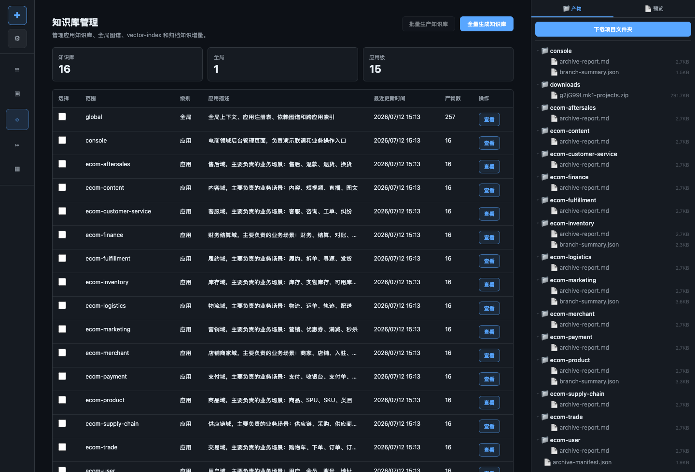
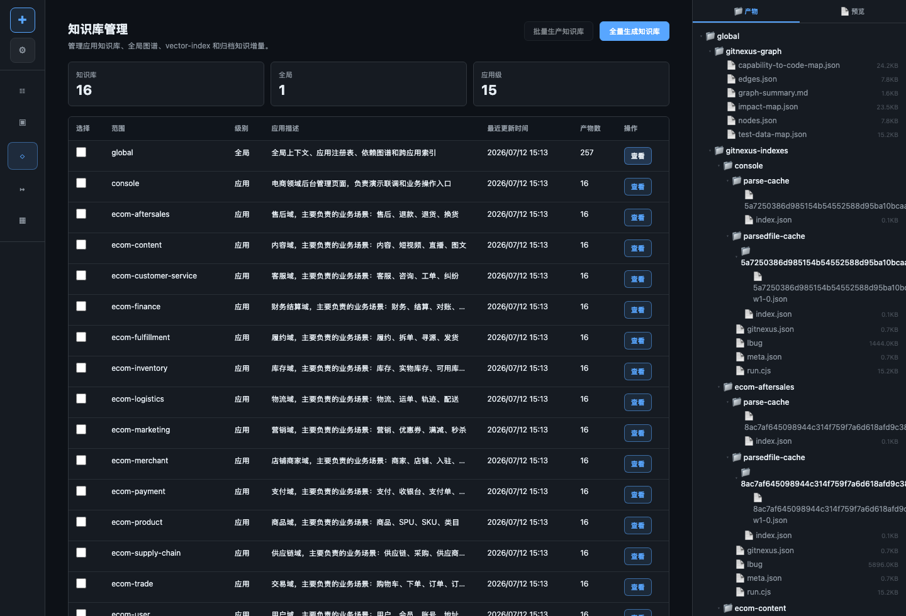

# 知识库管理产品演示与技术方案

知识库管理负责把应用代码、仓库结构、接口、依赖、业务术语和历史归档沉淀为可检索的事实材料。AI Coding、AI Testing 和 AI Ops 都依赖知识库来做影响面判断。

## 产品特色

- 把应用代码和业务解释整理成 Agent 可读的知识库。
- 支持应用级知识库和全局知识库两层结构。
- 能生成业务能力、API 路由、依赖关系、数据库表、测试造数建议。
- 需求归属确认、跨应用测试和告警影响面都复用同一套知识事实。
- 避免在代码里写死业务关键词到应用名的映射。

## 演示路径

1. 进入知识库管理页面。
2. 查看知识库数量和应用级知识库列表。
3. 点击知识库查看产物。
4. 查看 global 知识库中的应用能力和依赖索引。
5. 启动需求 PI，观察需求归属确认如何引用知识库证据。

## 示例

### 应用级知识库片段

```text
# ecom-inventory 应用知识库

## 核心能力
- 库存查询
- 库存保护
- 可用库存校验

## 依赖关系
- 被 ecom-marketing 在活动创建链路调用
- 与商品 SKU 通过 skuId 关联
```

### Global 知识库命中示例

```text
术语：库存保护
候选应用：ecom-inventory
证据：
  - capability-map: inventory.stock.guard
  - dependency-map: ecom-marketing -> ecom-inventory
  - app-domain-map: inventory domain
```

### MRD 归属示例

```text
MRD 关键词：商品上架、库存保护、活动创建
命中：
  - ecom-product: 商品上架状态
  - ecom-inventory: 库存保护
  - ecom-marketing: 活动创建
  - console: 运营后台页面
```

## 目标

- 为每个应用生成应用级知识库。
- 合并应用知识库为全局知识库。
- 维护知识库新鲜度和生成状态。
- 为需求归属、测试范围、运维影响面提供可追溯证据。
- 避免在代码里写死业务别名到应用名的映射。

## 产品定位

知识库管理是平台的“业务和架构事实库”。它把代码扫描、应用管理、接口、数据库、依赖和历史归档整理成 Agent 能稳定读取的材料。

如果没有知识库，AI Coding 会倾向于根据 MRD 关键词猜应用；有知识库后，系统可以把每个判断落到可追溯证据。

## 页面视角

### 知识库列表



### 知识库产物预览



## 应用级知识库

应用级知识库面向单个应用，通常包含：

- 应用概览
- 核心业务能力
- API / 路由
- 数据库表和字段含义
- 上下游依赖
- 关键代码入口
- 测试和造数建议
- 历史需求关联

这些内容主要服务于单应用理解：这个应用负责什么、提供什么接口、依赖什么、改动风险在哪里。

示例路径：

```text
demo/ecom/spaces/knowledge/app-knowledge/<app>/
```

## 全局知识库

全局知识库负责跨应用检索和影响面分析，通常包含：

- `app-domain-map`
- `capability-map`
- `api-route-map`
- `dependency-map`
- `impact-map`
- 业务术语索引
- 应用注册表

这些内容主要服务于跨应用判断：MRD 命中哪些业务域、哪些应用拥有该能力、哪些上下游需要纳入测试或回归。

示例路径：

```text
demo/ecom/spaces/knowledge/knowledge-base/
```

## 生成链路

```text
应用管理列表
  -> 仓库扫描
  -> 应用级知识库生成
  -> global 知识库合并
  -> 新鲜度记录
  -> 供 MRD / Testing / Ops 检索
```

生成后需要记录新鲜度，避免使用过期知识库做影响面判断。代码或仓库结构变化后应刷新对应应用知识库，并重新合并 global 知识库。

## 在需求 PI 中的使用

需求归属确认会按以下顺序使用知识库：

1. 从 MRD 提取业务关键词、业务域、验收场景。
2. 查询 global 知识库，召回候选应用。
3. 读取候选应用的应用级知识库，验证业务能力归属。
4. 生成结构化 `requirement-ownership.json`。
5. 生成 `fanout-decision.json`。

## 在 AI Testing 中的使用

AI Testing 使用知识库确定：

- 需要覆盖的跨应用链路。
- 造数依赖哪些领域数据。
- 哪些接口适合做集成测试断言。
- 哪些上下游应用需要纳入回归范围。

## 在 AI Ops 中的使用

AI Ops 使用知识库确定：

- 告警应用的业务上下文。
- 异常接口对应的业务能力。
- 可能受影响的上下游应用。
- 推荐排查顺序和修复风险。

## 关键模块

```text
src/knowledge/
src/agents/knowledge/
src/tools/knowledge/
src/tools/knowledge/app-knowledge/
src/workflows/definitions/knowledgeBaseWorkflow.ts
demo/ecom/spaces/knowledge/
```

## 截图


