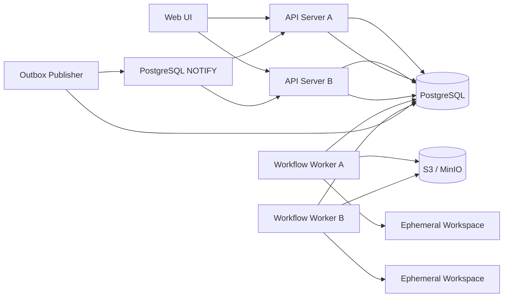

# 持久化架构升级与 Demo 依赖解耦技术方案

## 1. 背景

AI Coding 当前已经具备需求 PI、多应用分支、Agent 执行、AI Testing、生命周期产物和 AI Ops 等完整业务链路，但运行状态和示例数据仍以单机文件系统为中心：

- `execution-state.json` 保存 session / pipeline 主状态。
- `agents/*.json` 保存 Agent 状态和计划。
- `logs/events.ndjson` 保存事件轨迹。
- `artifacts/lifecycle-state.json` 保存生命周期事实。
- `langgraph/checkpoints/*.json` 保存 LangGraph checkpoint。
- `runtime-projects/` 同时承担状态、工作区、上传文件、产物和日志目录。
- 应用管理、需求管理、AI Testing 和 AI Ops 仍直接引用 `demo/ecom` 或 `demo/mrd`。

该实现适合单机开发和演示，但存在以下生产化问题：

1. 多个进程同时更新同一 JSON 时没有事务和并发控制。
2. 进程内 singleton、文件流和内存事件监听器无法跨实例共享。
3. API、工作流执行和本地工作区绑定在同一台机器上。
4. 文件状态难以分页查询、索引、审计、备份和按租户隔离。
5. `demo/` 不存在时，应用列表、MRD 列表、跨应用测试或运维证据能力会退化。
6. `runtime-projects` 既是事实存储又是执行缓存，无法安全设置统一清理策略。

## 2. 目标

### 2.1 持久化目标

- PostgreSQL 成为结构化运行状态的唯一事实源。
- 状态流转、生命周期更新和事件登记支持原子事务。
- 支持 API Server 和 Worker 多实例部署。
- 同一个 run / node 不会被多个 Worker 重复执行。
- 支持进程重启、Worker 宕机、租约过期后的安全恢复。
- 大文件、截图、报告和归档包进入 S3 兼容对象存储。
- `runtime-projects` 只保存可重建、可过期的本地工作区和缓存。
- 保留 file adapter 作为开发、测试和迁移期兼容模式。

### 2.2 Demo 解耦目标

- `src/` 生产代码不得硬编码 `demo/ecom`、`demo/mrd` 或具体 ecom 测试脚本。
- 应用目录、需求源、测试仓库和运维证据通过稳定接口注入。
- 默认启动不加载 Demo 数据；启用 Demo 必须显式选择 profile 或执行 seed。
- 删除或重命名 `demo/` 后，构建、单元测试、服务启动和非 Demo 核心 API 仍正常。
- Demo 可留在当前仓库、迁移到 `examples/`，或拆成独立仓库，而不影响生产代码。

### 2.3 可验证结果

完成后应满足：

```text
两个 API 实例 + 两个 Worker
  -> 同时竞争同一待执行节点
  -> 只有一个 Worker 获得有效租约
  -> 状态与事件在同一事务中提交
  -> 任意 API 实例都能查询状态并收到实时事件
  -> Worker 异常退出后，其他 Worker 在租约到期后安全接管
```

## 3. 非目标

本变更不包含：

- 用户登录、SSO、RBAC 的完整实现。
- 完整 SCM、PR 平台或制品仓库建设。
- 把 Git 工作区和源码内容写入 PostgreSQL。
- 一次性移除所有文件系统操作。
- 重写 legacy / LangGraph 的业务工作流定义。
- 立即删除 `demo/`；删除动作必须在解耦验收完成后单独执行。

## 3.1 Demo 资产处置决定

本次升级期间，Demo 资产继续保留在仓库根目录的 `demo/`，不移动也不删除。它是本地演示、显式 `ecom-demo` profile 和独立 E2E 覆盖的受版本控制夹具，不是生产运行时依赖。

- `production` 与 `local` profile 不得扫描、读取或回退到 `demo/`。
- 只有 `AI_CODING_PROFILE=ecom-demo` 的组合根可以注册 Demo 应用、MRD、测试仓库与 Ops 目录适配器。
- 移到 `examples/` 或拆出独立仓库是后续仓库治理决策；在独立 Demo E2E 与生产无 Demo CI 稳定前，不进行路径迁移。

## 4. 核心技术决策

| 领域 | 决策 | 说明 |
| --- | --- | --- |
| 结构化状态 | PostgreSQL 16+ | 唯一事实源，提供事务、锁、索引和恢复能力 |
| 数据访问 | `pg` + 显式 Repository + SQL migration | 避免业务层绑定 ORM；复杂 JSON 状态使用 JSONB |
| 实时通知 | PostgreSQL `LISTEN/NOTIFY` | 只做低延迟唤醒，不作为事件事实源 |
| Worker 调度 | PostgreSQL lease + fencing token | 通知连接故障不应导致同一节点被双重提交 |
| 事件一致性 | Transactional Outbox | 状态变更和待发布事件在同一事务提交 |
| 大文件 | S3 / MinIO | 产物内容、截图、日志包、下载包进入对象存储 |
| 本地文件 | Local artifact adapter | 开发和测试环境可继续使用本地目录 |
| 工作区 | Worker 本地临时目录 | 从 SCM / 上传包重建，任务结束后按策略清理 |
| 数据建模 | 关系字段 + JSONB 混合 | 可查询字段关系化，复杂快照保留现有领域结构 |
| Demo | 显式 Provider / Profile / Seed | 生产默认关闭，Demo 仅作为可选数据源 |

`LISTEN/NOTIFY` 不承担消息永久保存。跨实例正确性由 PostgreSQL 的事件表、版本号、租约和 fencing token 保证。

## 5. 目标架构

### 5.1 运行时与依赖版本

- Node.js：20 或更高版本；S3 SDK 的当前依赖链要求 Node 20+。
- PostgreSQL：16 或更高版本。
- 对象存储：AWS S3 或兼容 S3 API 的 MinIO。
- Node 依赖：`pg`、`@aws-sdk/client-s3`、`@aws-sdk/s3-request-presigner` 和 `node-pg-migrate`，版本由 `package-lock.json` 锁定。



职责边界：

- API Server：鉴别请求、写入命令、读取状态、提供 WebSocket，不直接长期执行 workflow。
- Workflow Worker：领取节点租约、准备工作区、运行 Agent / Tool、提交结果。
- PostgreSQL：保存 session、node、agent、lifecycle、event、lease、outbox 和 artifact metadata。
- PostgreSQL `LISTEN/NOTIFY`：把已提交事件的轻量通知发送给所有 API 实例；事件内容仍从事件表读取。
- S3 / MinIO：保存不可直接放入数据库的大对象。
- Worker 本地目录：保存执行期间需要 POSIX 语义的代码 checkout 和构建缓存。

## 6. 存储边界

### 6.1 必须进入 PostgreSQL

- Session / Run 基本信息与状态。
- Workflow snapshot、动态 `workflowInstance` 和分支状态。
- Node、Project、Track 的当前状态与重试计数。
- Agent 状态、模型选择、token 用量和 plan。
- Lifecycle 当前快照和可查询索引。
- 审批、部署、测试、质量门禁、诊断和归档引用。
- Pipeline event 和审计 event。
- Artifact metadata、checksum、producer 和 storage key。
- Worker lease、fencing token、heartbeat 和幂等键。
- 自定义 workflow 定义及版本。

### 6.2 必须进入对象存储

- 上传的 MRD、压缩包和附件。
- Agent transcript 大文本。
- 编译日志、测试报告、覆盖率报告。
- Playwright 截图和 report。
- 归档 zip 和代码下载包。
- 正式业务 artifact 内容。

数据库只保存这些对象的元数据：

```text
artifact_id
run_id
kind
storage_key
content_type
size_bytes
sha256
producer_node_id
created_at
retention_class
```

### 6.3 保留在 Worker 本地

- Git checkout。
- Maven / npm 构建目录。
- Agent 工具需要直接读写的工作区。
- 下载到本地的短期输入文件。
- 可安全重建的 GitNexus 临时索引。

本地目录必须带 `runId`、`workerId` 和过期时间，不能再承担唯一事实存储职责。

## 7. 持久化接口设计

新增 `src/storage/`，业务模块只依赖接口，不直接依赖 PostgreSQL、S3 或本地文件实现。

```text
src/storage/
  contracts/
    runRepository.ts
    agentRepository.ts
    lifecycleRepository.ts
    eventRepository.ts
    workflowRepository.ts
    artifactStore.ts
    leaseRepository.ts
    unitOfWork.ts
  postgres/
    postgresRunRepository.ts
    postgresAgentRepository.ts
    postgresLifecycleRepository.ts
    postgresEventRepository.ts
    postgresWorkflowRepository.ts
    postgresLeaseRepository.ts
    postgresUnitOfWork.ts
  file/
    fileRunRepository.ts
    fileAgentRepository.ts
    fileLifecycleRepository.ts
    fileEventRepository.ts
    fileWorkflowRepository.ts
  artifacts/
    localArtifactStore.ts
    s3ArtifactStore.ts
  events/
    outboxPublisher.ts
    postgresEventBus.ts
```

核心接口统一改为异步：

```ts
export interface RunRepository {
  create(state: ExecutionState): Promise<void>;
  findById(runId: string): Promise<ExecutionState | null>;
  list(query: RunListQuery): Promise<Page<ExecutionState>>;
  save(state: ExecutionState, expectedVersion: number): Promise<number>;
  delete(runId: string): Promise<boolean>;
}

export interface LifecycleRepository {
  findByRunId(runId: string): Promise<LifecycleState | null>;
  update(
    runId: string,
    expectedVersion: number,
    updater: (state: LifecycleState) => LifecycleState,
  ): Promise<Versioned<LifecycleState>>;
}

export interface ArtifactStore {
  put(input: ArtifactPutInput): Promise<ArtifactObject>;
  get(storageKey: string): Promise<ReadableStream>;
  stat(storageKey: string): Promise<ArtifactObject | null>;
  delete(storageKey: string): Promise<void>;
}

export interface LeaseRepository {
  acquire(key: string, ownerId: string, ttlMs: number): Promise<Lease | null>;
  renew(lease: Lease, ttlMs: number): Promise<Lease>;
  release(lease: Lease): Promise<void>;
}
```

现有 `StateStore`、`EventLog`、lifecycle store 和 workflow storage 先变成 file adapter，避免第一阶段同时改变业务行为和存储实现。

## 8. 数据模型

### 8.1 核心表

#### `runs`

| 字段 | 类型 | 说明 |
| --- | --- | --- |
| `run_id` | varchar PK | 当前 nanoid |
| `tenant_id` | varchar | 为后续租户隔离预留，MVP 使用 `default` |
| `requirement_id` | varchar nullable | 生命周期需求 ID |
| `name` | varchar | 会话名称 |
| `description` | text nullable | 会话说明 |
| `status` | varchar | idle/running/... |
| `current_node_id` | varchar nullable | 当前节点 |
| `current_node_index` | integer | 兼容现有读模型 |
| `permission_mode` | varchar | 工具权限模式 |
| `model_overrides` | jsonb | 模型覆盖 |
| `workflow_instance` | jsonb | 动态拓扑快照 |
| `metadata` | jsonb | 兼容扩展字段 |
| `version` | bigint | 乐观锁版本 |
| `started_at` | timestamptz | 创建时间 |
| `updated_at` | timestamptz | 更新时间 |
| `completed_at` | timestamptz nullable | 终态时间 |
| `deleted_at` | timestamptz nullable | 软删除时间 |

#### `run_nodes`

主键为 `(run_id, node_id)`，保存节点状态、确认门、失败次数、Agent 引用、输出 artifact IDs 和版本号。节点状态独立成表，避免每次进度更新重写整个 run JSON。

#### `run_projects`

主键为 `(run_id, project_name)`，保存 branch、project、track、retry 和 artifact index。复杂 track 结构可先放 JSONB，常用状态单独建列。

#### `agent_runs`

保存 `AgentState` 的可查询字段，`plan`、模型切换历史和 artifact 引用使用 JSONB。`agent_run_id` 唯一。

#### `lifecycle_states`

保存 lifecycle 当前快照：

```text
run_id PK
requirement_id
phase
status
payload jsonb
version
created_at
updated_at
```

Lifecycle 内部数组在第一阶段继续保存在 `payload`。部署、测试和审批需要跨 run 检索时，再增量投影到专用索引表，避免一次性过度拆表。

#### `run_events`

```text
event_id varchar unique
run_id varchar
sequence bigint
event_type varchar
node_id varchar nullable
agent_run_id varchar nullable
payload jsonb
occurred_at timestamptz
```

`(run_id, sequence)` 唯一，用 sequence 替代只按毫秒时间戳翻页，保证同一 run 内严格有序。

#### `artifact_refs`

保存 artifact metadata 和对象存储引用，不保存大文本或二进制内容。

#### `execution_leases`

```text
lease_key varchar PK
owner_id varchar
fencing_token bigint
lease_until timestamptz
heartbeat_at timestamptz
payload jsonb
```

每次成功 acquire 都递增 `fencing_token`。Worker 提交节点结果时必须携带 token；旧 Worker 即使恢复运行，也无法覆盖新 Worker 的结果。

#### `outbox_events`

保存事务提交后待发布的事件，包含租户、publish 状态、重试次数和下次重试时间。publisher 跨租户领取到期记录，并用单条 `UPDATE ... RETURNING pg_notify(...)` 同时发送通知和写入 `published_at`；语句失败时二者一起回滚。

### 8.2 必要索引

- `runs(tenant_id, updated_at desc)`。
- `runs(status, updated_at)`。
- `run_nodes(run_id, status)`。
- `agent_runs(run_id, started_at desc)`。
- `run_events(run_id, sequence)`。
- `artifact_refs(run_id, created_at)`。
- `execution_leases(lease_until)`。
- `outbox_events(published_at, next_attempt_at)` partial index。

## 9. 事务、一致性与并发

### 9.1 状态流转事务

单次节点状态变更必须在一个数据库事务内完成：

```text
校验 run.version / node.version
  -> 校验 lease fencing token
  -> 更新 node 状态
  -> 更新 run / branch / join 读模型
  -> 更新 lifecycle 引用
  -> 登记 artifact metadata
  -> 插入 run_event
  -> 插入 outbox_event
  -> COMMIT
```

任何一步失败都整体回滚，不再出现状态已完成但事件或 lifecycle 仍缺失的情况。

### 9.2 乐观锁

所有可并发更新的聚合带 `version`：

```sql
UPDATE runs
SET status = $1, version = version + 1, updated_at = now()
WHERE run_id = $2 AND version = $3;
```

更新行数为 0 时抛出 `ConcurrentModificationError`，由调用层重新读取后重试有限次数，不允许静默覆盖。

### 9.3 Worker 租约

- lease key 使用 `run:{runId}:node:{nodeId}`。
- 默认 TTL 60 秒，每 20 秒 heartbeat。
- 外部 Maven、Playwright 或模型调用期间也必须续租。
- Worker 停止续租后，其他 Worker 可以获得更高 fencing token。
- 完成提交必须同时校验 node 尚未终态且 token 为最新值。
- 终态节点再次收到相同 idempotency key 时直接返回已有结果。

### 9.4 Outbox 与 WebSocket

业务事务只写 PostgreSQL。独立 publisher 不绑定默认租户，而是跨租户领取未发布 outbox；每条记录携带自己的 tenantId。publisher 使用单条 `UPDATE ... RETURNING pg_notify('ai_coding_run_events', payload)` 在同一 PostgreSQL 事务中写入 `published_at` 并发布轻量通知，避免进程在通知后、确认前崩溃形成的重复窗口。所有 API Server 使用独立数据库连接执行 `LISTEN ai_coding_run_events`，收到通知后按 eventId/sequence 读取持久事件并向本机 WebSocket 客户端广播。

客户端重连时不依赖 `NOTIFY` 历史消息，而是通过 `GET /api/sessions/:runId/events?afterSequence=` 从 PostgreSQL 补齐，再继续订阅实时事件。监听连接中断时自动重连，重复通知按 eventId 去重。

### 9.5 Artifact 一致性

对象不能和 PostgreSQL 共用一个事务，因此使用以下顺序：

1. 上传到带临时前缀的对象 key。
2. 校验 size 和 SHA-256。
3. 在业务事务中登记正式 artifact metadata。
4. 提交成功后把对象标记为 committed 或移动到正式 key。
5. 定时清理没有 metadata 的超时临时对象。

## 10. LangGraph Checkpoint

当前配置已声明 `memory | file | postgres`，但 postgres 尚未落地。本变更实现：

- file mode 保留给本地测试。
- postgres mode 使用 PostgreSQL checkpointer，`thread_id = runId`。
- checkpoint 和产品 `runs/run_nodes` 各有职责：checkpoint 用于图执行恢复，产品表用于查询、审计和 UI 读模型。
- workflow 节点完成时，通过 bridge 在同一业务边界同步产品状态；不得让 UI 直接解析 LangGraph 内部 checkpoint。
- legacy runtime 仍通过相同 Repository、lease 和 event 接口持久化，避免迁移期间出现两套一致性语义。

## 11. Demo 依赖解耦

### 11.1 当前耦合点

| 模块 | 当前依赖 | 改造方向 |
| --- | --- | --- |
| 应用管理 | `workspace/demo/ecom` | `ApplicationCatalog` + `RepositoryRegistry` |
| 需求管理 | `demo/mrd` | `RequirementSource` |
| AI Testing | 固定 `demo/ecom/ecom-integration-tests` | `TestingRepositoryResolver` |
| AI Ops 日志 | 固定 ecom `logs/` | `LogEvidenceProvider` |
| AI Ops 知识 | 固定 ecom knowledge 路径 | `KnowledgeEvidenceProvider` |
| 告警历史 | ecom 下 JSON 文件 | `AlertHistoryRepository` |
| 本地 Git 脚本 | 默认 `demo/ecom` | 显式 `--root` 或 repository registry |
| 测试 | 读取 `demo/mrd` | 独立 test fixture |

### 11.2 Provider 接口

新增：

```text
src/catalog/
  applicationCatalog.ts
  databaseApplicationCatalog.ts
  manifestApplicationCatalog.ts

src/requirements/sources/
  requirementSource.ts
  databaseRequirementSource.ts
  directoryRequirementSource.ts

src/testing/repositories/
  testingRepositoryResolver.ts
  registryTestingRepositoryResolver.ts

src/app-ops/evidence/
  logEvidenceProvider.ts
  knowledgeEvidenceProvider.ts
  alertHistoryRepository.ts
```

接口示例：

```ts
export interface ApplicationCatalog {
  list(): Promise<ManagedApplication[]>;
  get(appId: string): Promise<ManagedApplication | null>;
}

export interface RequirementSource {
  list(query?: RequirementQuery): Promise<ManagedRequirementOverview[]>;
  get(requirementId: string): Promise<ManagedRequirement | null>;
}

export interface TestingRepositoryResolver {
  resolve(input: {
    requirementId: string;
    appIds: string[];
    repositoryType: 'integration-testing';
  }): Promise<RepositoryRef | null>;
}

export interface LogEvidenceProvider {
  search(input: LogEvidenceQuery): Promise<OpsLogEvidence[]>;
}
```

### 11.3 Demo profile

Demo 不再由生产服务根据目录是否存在自动发现，改为显式 profile：

```bash
AI_CODING_PROFILE=production   # 默认，不加载 demo
AI_CODING_PROFILE=ecom-demo    # 本地演示
```

`ecom-demo` profile 负责：

- 注册 demo 应用 manifest。
- 注册 demo MRD 目录。
- 注册 ecom integration testing repository。
- 注册本地日志和知识库 provider。
- 可选执行数据库 seed。

生产 profile 必须从数据库、SCM/Harness、对象存储或显式配置获取这些资源。

### 11.4 示例数据归宿

解耦完成后的建议结构：

```text
examples/ecom/                 # 可选演示工程，可后续迁出仓库
fixtures/requirements/        # 仅测试使用的最小 MRD fixture
fixtures/storage-migration/   # JSON -> PostgreSQL 迁移 fixture
```

不得让 `src/` 通过 `process.cwd()` 推导 `examples/` 或 `fixtures/`。测试必须显式构造 provider，Demo 必须显式启用 profile。

## 12. 配置设计

新增配置：

```bash
AI_CODING_STORAGE_DRIVER=postgres       # file | postgres
DATABASE_URL=postgres://...
DATABASE_POOL_MIN=2
DATABASE_POOL_MAX=20

AI_CODING_EVENT_BUS=postgres            # memory | postgres

AI_CODING_ARTIFACT_STORE=s3             # local | s3
ARTIFACT_LOCAL_DIR=/var/lib/ai-coding/artifacts
S3_ENDPOINT=https://...
S3_BUCKET=ai-coding-artifacts
S3_REGION=...
S3_ACCESS_KEY_ID=...
S3_SECRET_ACCESS_KEY=...

AI_CODING_WORKSPACE_ROOT=/var/lib/ai-coding/workspaces
AI_CODING_WORKSPACE_RETENTION_HOURS=24
AI_CODING_PROFILE=production
AI_CODING_WORKER_ID=worker-${HOSTNAME}
```

配置启动校验：

- `storage=postgres` 时必须提供 `DATABASE_URL`。
- 多实例模式不得使用 memory event bus。
- `artifactStore=s3` 时必须提供 bucket 和凭证来源。
- production profile 禁止隐式回退到 `demo/`。
- production profile 禁止数据库连接失败后自动切回 file，以免形成分裂事实源。

## 13. API 与运行时改造

### 13.1 异步化

当前 `StateStore` 和 `SessionManager` 大量使用同步文件 API。Repository 切换到 PostgreSQL 后，下列调用链统一异步：

```text
controller
  -> product service
  -> SessionManager / workflow runtime
  -> Repository / UnitOfWork
```

禁止在业务层通过 `void repository.save()` 忽略持久化结果。状态提交失败必须让节点保持未完成并进入可恢复状态。

### 13.2 SessionManager

- 移除以目录枚举作为 session 列表来源的逻辑。
- `listSessions` 改为数据库分页查询。
- `getSession` 从 repository 加载 run、events 和 agents。
- `deleteSession` 先软删除数据库记录，再异步清理对象与工作区。
- `recoverOnStartup` 改为 Worker lease recovery，不再把所有 running session 无条件改成 suspended。
- 进程内 repository registry 只能缓存无状态 client，不能缓存权威业务状态。

### 13.3 Pipeline / Agent

- Pipeline Engine 每次执行节点前必须获得 lease。
- Agent 状态按 turn 或关键状态点持久化，使用版本号防止旧进程覆盖。
- Tool 产生的 artifact 先写 ArtifactStore，再登记 metadata。
- permission decision 进入审计事件表；本地 NDJSON 可作为调试导出而非事实源。

### 13.4 文件下载与浏览

- `/files` 返回 artifact metadata 或当前 Worker 工作区的受控视图。
- `/files/content` 对正式 artifact 通过 ArtifactStore 读取。
- 下载大对象优先返回短期 presigned URL。
- workspace 文件仍通过受控 API 读取，不允许 API Server 假设工作区位于本机。

## 14. 迁移方案

### 14.1 原则

- 不做无期限双主写入。
- file 和 postgres 只能有一个权威读源。
- 迁移期允许 shadow write 和 shadow compare，但失败不得改变主源。
- 切换到 PostgreSQL 后，如需回滚 file mode，必须先执行数据库导出。

### 14.2 阶段

#### 阶段 A：接口收口

- 引入 storage contracts。
- 把现有文件实现迁入 file adapter。
- 所有行为和文件格式保持不变。
- 增加 file/postgres 共用 contract tests。

#### 阶段 B：PostgreSQL shadow write

- file 仍为权威源。
- 每次状态保存后异步镜像到 PostgreSQL。
- 记录失败指标，不影响当前请求。
- 定时比较 file 和 postgres 的规范化快照 checksum。

#### 阶段 C：历史数据回填

提供：

```bash
npm run storage:migrate -- --from runtime-projects --dry-run
npm run storage:migrate -- --from runtime-projects --apply
npm run storage:verify -- --from runtime-projects
```

迁移内容：

- execution state。
- agent state 和 plan。
- lifecycle state。
- events NDJSON，生成 run 内 sequence。
- workflow definitions。
- artifact metadata；内容按配置上传对象存储。
- LangGraph checkpoint。

每个 run 单独事务，迁移记录包含 source checksum、目标版本、结果和错误，可重复执行。

#### 阶段 D：PostgreSQL 主读写

- 配置切换 `AI_CODING_STORAGE_DRIVER=postgres`。
- file 不再被业务读取。
- 可选 file snapshot exporter 仅用于紧急回滚和人工排查。
- 开启 Worker lease、outbox 和 PostgreSQL 实时通知。

#### 阶段 E：清理

- 删除 shadow writer。
- `runtime-projects/runs` 设置 TTL。
- 只保留 migration reader 一至两个版本周期。
- 解耦验收通过后，再决定删除或迁出 `demo/`。

## 15. 兼容与回滚

### 15.1 兼容策略

- API response shape 保持不变。
- `ExecutionState` 和 `LifecycleState` 领域类型第一阶段不重写。
- 历史 artifact path 通过 compatibility resolver 映射到 storage key。
- file adapter 继续运行现有单元测试和本地开发。
- Demo fixture 只通过测试 provider 加载。

### 15.2 回滚策略

- 阶段 A～C：直接切回 file 权威源。
- 阶段 D 后：暂停写入，运行 `storage:export` 生成兼容快照，验证 checksum 后切回。
- 数据库 migration 必须遵循 expand/contract，不在同一次发布删除旧列。
- 对象存储内容在回滚窗口内不得清理。
- `LISTEN/NOTIFY` 不保存权威数据，监听故障时 WebSocket 可退化为数据库轮询与 sequence replay。

## 16. 可观测性

新增指标：

- `storage_operation_duration_ms{repository,operation}`。
- `storage_operation_errors_total{repository,operation}`。
- `run_version_conflicts_total`。
- `lease_acquire_total{result}`。
- `lease_expired_total`。
- `outbox_pending_count`。
- `outbox_publish_retries_total`。
- `artifact_upload_duration_ms`。
- `artifact_orphan_count`。
- `workspace_active_count`。
- `demo_fallback_attempt_total`，production 环境必须为 0。

结构化日志必须包含：

```text
runId
nodeId
agentRunId
workerId
leaseKey
fencingToken
transactionId
eventSequence
```

## 17. 安全要求

- 数据库和对象存储凭证只能来自 secret manager 或环境变量，不写入配置文件。
- PostgreSQL 强制 TLS，生产使用最小权限账号。
- artifact storage key 不包含用户原始文件名中的路径字符。
- presigned URL 使用短 TTL。
- 数据表预留 `tenant_id`，所有 repository 查询必须显式带租户上下文。
- 数据迁移工具默认 dry-run，apply 必须显式指定。
- 生产 profile 不允许读取仓库内 Demo 日志或 Demo 知识库。

## 18. 测试方案

### 18.1 Repository contract tests

同一组测试分别运行 file 和 postgres adapter：

- create / read / update / list / delete。
- 乐观锁冲突。
- 事务回滚。
- event sequence 顺序。
- artifact metadata 一致性。
- malformed legacy file 迁移失败隔离。

### 18.2 并发和故障测试

- 两个 Worker 同时 acquire 同一个 node，只有一个成功。
- 旧 Worker 租约过期后提交，被 fencing token 拒绝。
- 状态已提交但 PostgreSQL 通知连接暂时不可用，outbox 后续补发。
- 对象上传成功、数据库事务失败，临时对象被回收。
- 数据库连接中断时节点不被错误标记 completed。
- API 实例重启后 WebSocket 客户端可按 sequence 补齐事件。

### 18.3 Demo 解耦测试

CI 增加硬门禁：

```bash
mv demo demo.disabled
npm run build
npm test
AI_CODING_PROFILE=production npm start
```

并增加静态扫描：

```text
src/** 不得出现 demo/ecom、demo/mrd、ecom-integration-tests 硬编码路径
```

Demo profile 单独验证应用列表、MRD、AI Testing 和 AI Ops 示例链路。

### 18.4 迁移测试

- 使用最小 fixture、完整历史 fixture 和损坏 fixture。
- 重复执行 migration 不产生重复 event 或 artifact。
- 源/目标规范化 checksum 相等。
- 随机抽样回放 transcript 和 lifecycle read model。

### 18.5 压测目标

MVP 验收基线：

- 100 个并发活跃 run。
- 20 个并发 Worker node execution。
- 单 run 10 万条 event 仍可稳定按 sequence 分页。
- session 列表 P95 小于 300 ms。
- 状态更新 P95 小于 200 ms，不包含模型和工具执行时间。
- 单 Worker 异常后 90 秒内完成接管。

## 19. 实施计划

按 2 名后端工程师估算 8 周：

| 周期 | 工作内容 | 交付物 |
| --- | --- | --- |
| 第 1 周 | Storage contracts、ADR、数据库 schema、file adapter 收口 | 接口与 contract tests |
| 第 2 周 | PostgreSQL run/node/agent/event repository | 核心状态可写入数据库 |
| 第 3 周 | lifecycle、workflow、artifact metadata、migration CLI | 完整状态回填能力 |
| 第 4 周 | S3/MinIO artifact store、本地 workspace 生命周期 | 大文件与本地状态分离 |
| 第 5 周 | lease、fencing token、outbox、PostgreSQL WebSocket 通知 | 多 Worker / 多 API 实例 |
| 第 6 周 | Application/Requirement/Testing/Ops Provider 解耦 | 生产代码不依赖 demo 路径 |
| 第 7 周 | shadow compare、历史数据迁移、兼容与回滚 | 可灰度切换 PostgreSQL |
| 第 8 周 | 并发测试、故障测试、压测、文档和上线演练 | 生产验收报告 |

任务可以拆为以下 Epic：

1. Storage SPI 与 file adapter 收口。
2. PostgreSQL schema 与 repository 实现。
3. Artifact Store 与 workspace 生命周期。
4. 多实例 lease、outbox 与事件总线。
5. LangGraph PostgreSQL checkpoint。
6. Application / Requirement 数据源解耦。
7. AI Testing 测试仓库解耦。
8. AI Ops 证据源与历史存储解耦。
9. JSON 历史数据迁移与校验工具。
10. 灰度、压测、故障恢复与 Demo 独立验收。

## 20. 验收标准

### 20.1 持久化

- PostgreSQL 模式下删除 `runtime-projects/runs` 不丢失 session、状态、事件和正式 artifact。
- 所有核心状态更新带事务和 version 校验。
- 两个 Worker 不会成功提交同一节点的不同结果。
- 任意 API 实例都能读取全部 session 并推送实时事件。
- Worker 宕机后可以自动接管，不需要人工修改 JSON。
- 大 artifact 不进入数据库，数据库仅保存 metadata。
- 历史 JSON run 可迁移、校验并回放。

### 20.2 Demo 解耦

- `src/` 不包含 Demo 绝对或相对硬编码路径。
- production profile 在没有 `demo/` 时正常启动。
- 应用、需求、测试仓库和 Ops 证据均来自 Provider。
- Demo profile 可显式启用且演示能力不退化。
- 测试 fixture 与产品 Demo 数据分离。
- 删除 `demo/` 的决策不再影响生产功能。

### 20.3 工程质量

- architecture boundary tests 全绿。
- file/postgres contract tests 全绿。
- 并发、租约过期、outbox 重试和迁移幂等测试全绿。
- 无数据库失败自动回退 file 的分裂事实源行为。
- 上线、回滚、备份恢复和对象清理均有 runbook。

## 21. 风险与应对

| 风险 | 影响 | 应对 |
| --- | --- | --- |
| 同步存储 API 异步化范围较大 | 改动调用链广 | 先收口接口，再分模块迁移；禁止边改业务边换存储 |
| lifecycle 大 JSON 并发更新冲突 | 高频重试 | 第一阶段 version 锁；热点数组逐步投影成独立表 |
| 双写形成不一致 | 两套事实源 | shadow write 只用于比对，明确唯一权威读源 |
| Worker 长任务租约失效 | 重复执行 | heartbeat + fencing token + 幂等提交 |
| 对象存储与数据库非原子 | 孤儿对象或悬空引用 | 临时 key、checksum、提交标记和定时回收 |
| Demo 拆除导致产品展示退化 | 演示不可用 | 显式 ecom-demo profile 和独立 E2E |
| 一次性拆表过度 | 交付延期 | 关系字段 + JSONB，按查询需求渐进规范化 |
| file 兼容长期存在 | 维护两套实现 | 设定一至两个版本周期后移除迁移外兼容代码 |

## 22. 完成定义

本任务只有同时满足以下条件才算完成：

1. PostgreSQL 已成为生产 profile 的唯一结构化状态事实源。
2. 多实例并发、租约接管和事件补发经过自动化验证。
3. Artifact 与本地 workspace 已从权威状态中分离。
4. `src/` 对 `demo/` 的硬编码依赖为零。
5. Demo profile 和 production profile 分别通过 E2E。
6. 历史 JSON 数据具备可重复、可校验、可回滚的迁移路径。
7. `runtime-projects` 可以按 TTL 清理且不会造成正式状态丢失。
