# 产品演示流程

本文档用于演示 AI Coding Pipeline 的完整产品链路。演示数据来自真实跑通的“营销活动软删除”需求，服务启动后默认显示为 `完整流程演示 Demo`。

## 1. 打开首页

启动服务后进入首页，左侧会话列表默认出现 `完整流程演示 Demo`。点击会话后，可以看到完整流水线已经执行到 `Archive`。


演示讲解点：

- 这是一次真实运行快照，不是前端写死的假数据。
- 节点、事件、Agent 状态、工具调用、产物都来自同一个 run。
- 新用户不用先配置模型，也能先理解产品价值和交互方式。

## 2. 基础配置和模型设置

进入设置页，可以配置模型服务、JDK 和 Maven。


模型支持动态切换，不同阶段可以使用不同模型。


演示讲解点：

- 真实执行时需要配置模型 API。
- Java 实现和测试节点会使用 JDK/Maven 路径。
- 配置保存在本地 `.ai-coding/`，不会进入 Git。

## 3. 新建任务

点击新建任务，上传需求文件和项目源码。


上传完成后，在 `Upload / Init` 节点可以查看输入内容，包括 MRD 和项目包。


演示讲解点：

- 需求文件进入 `workspace/input`。
- 项目代码进入 `workspace/project`。
- 系统会生成 `artifacts/input-summary.md` 和 `artifacts/project-manifest.json`。

## 4. 需求拆解

`需求拆解` 节点会读取需求文档和项目结构，生成最终需求拆解清单。


节点执行轨迹会展示读取文件、写入产物和确认门事件。

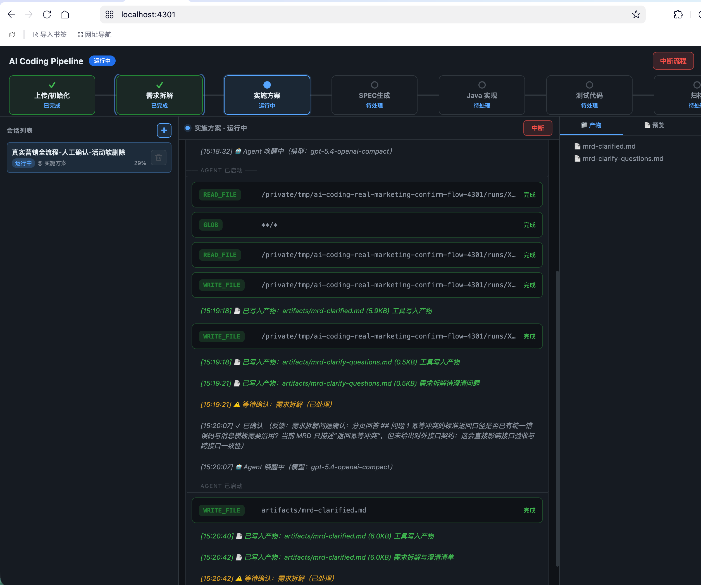

如果模型判断仍有需要用户确认的问题，会以分页方式展示澄清问题。用户可以逐题选择默认答案，也可以补充说明。

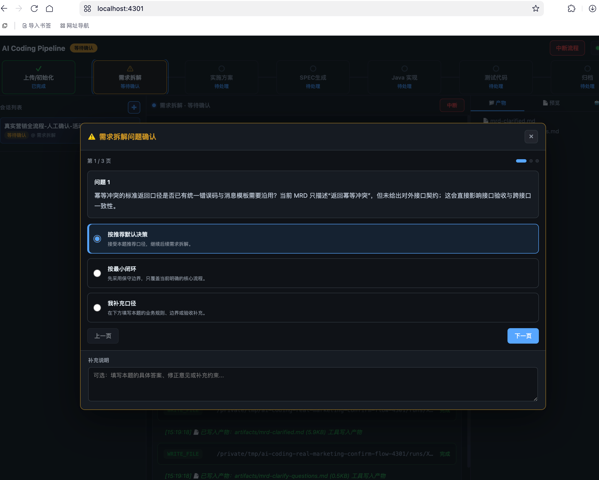

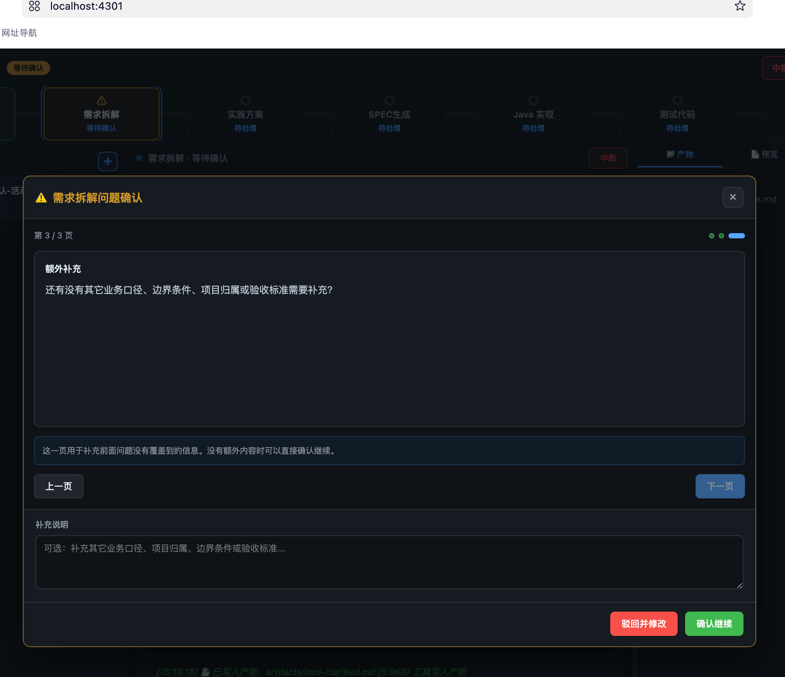

确认后的需求清单会成为下游唯一业务输入。

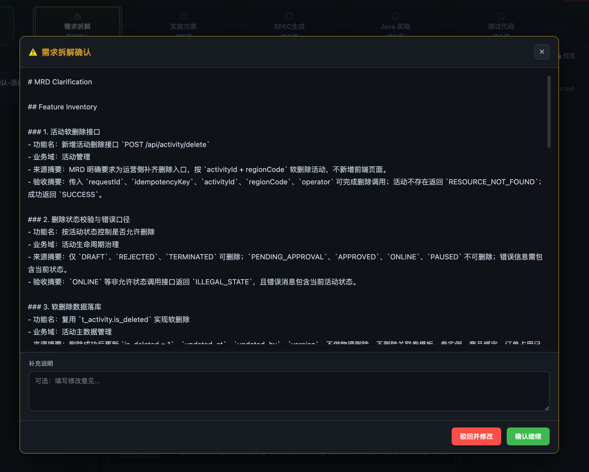

核心产物：

- `artifacts/mrd-clarified.md`
- `artifacts/mrd-clarify-questions.md`

演示讲解点：

- 这个节点不是复述 MRD 原文，而是拆出功能列表、项目归属、边界和待确认问题。
- 用户反馈会写回节点上下文，当前节点重跑后再继续下游。

## 5. 实施方案

`实施方案` 节点会基于澄清后的需求生成 PRD 和项目级技术方案。

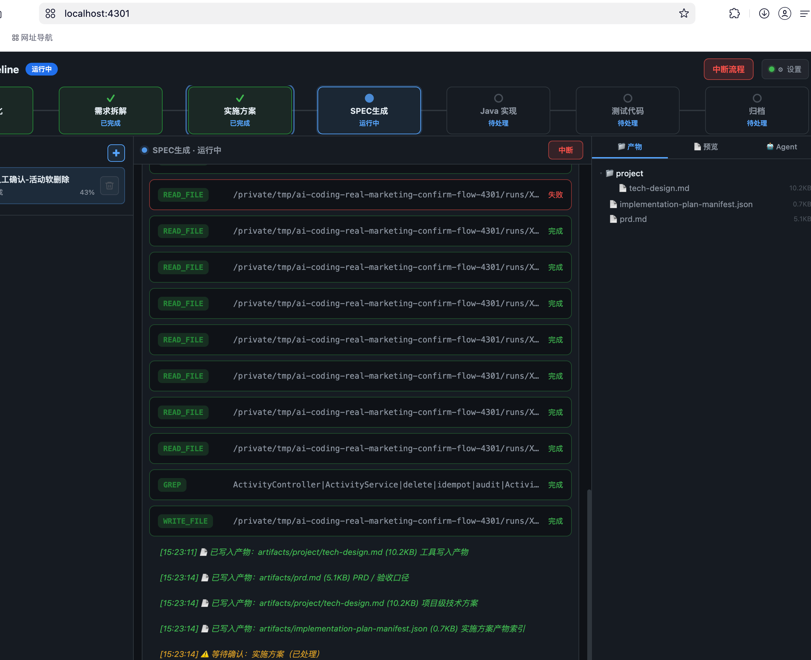

方案会进入确认门，用户确认后才继续生成 Spec。

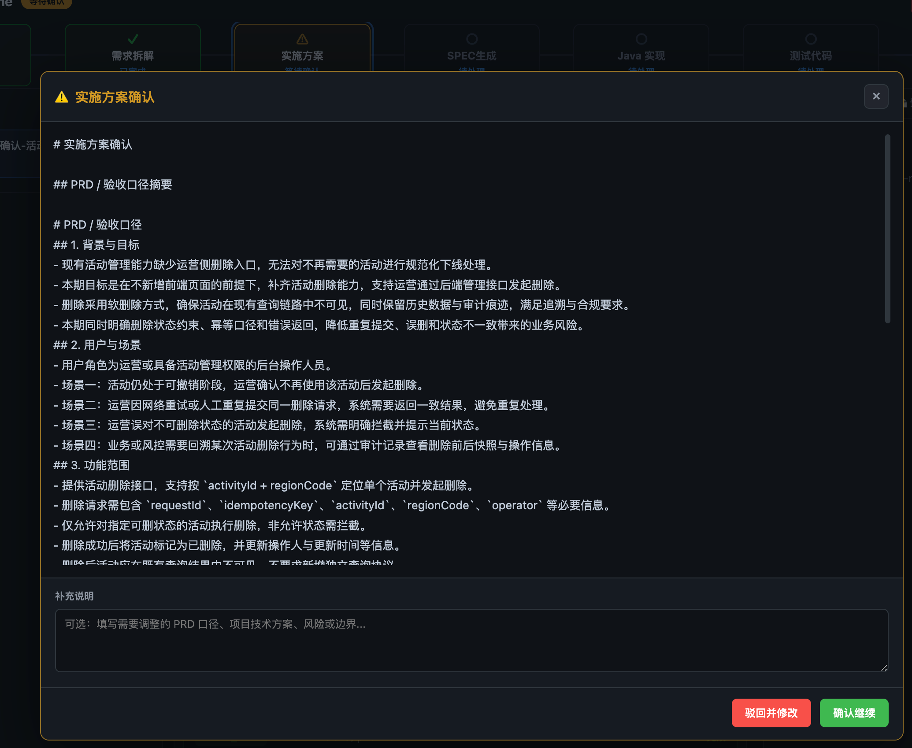

产物会以结构化 Markdown 展示，便于阅读和复核。

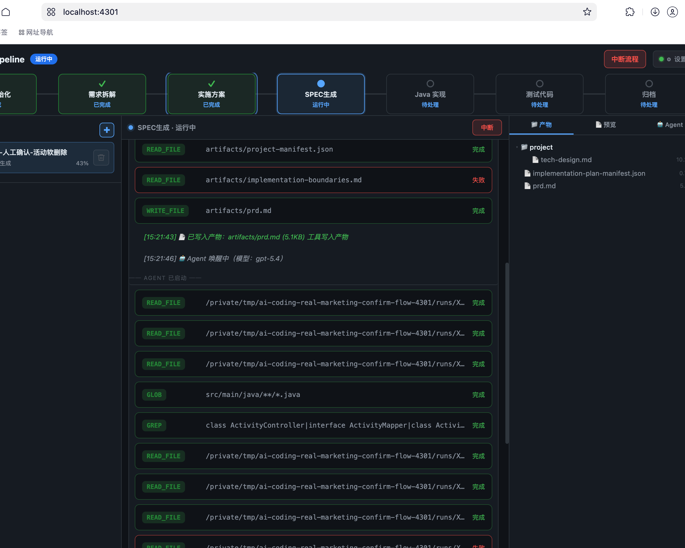

核心产物：

- `artifacts/prd.md`
- `artifacts/implementation-plan-manifest.json`
- `artifacts/<project>/tech-design.md`

演示讲解点：

- PRD 描述验收口径。
- 技术方案描述项目内的实现边界、候选文件、测试策略和风险。
- 下游不依赖对话 transcript，而是读取这些正式产物。

## 6. Spec 任务清单

`SPEC生成` 节点会产出面向开发和测试的任务清单。

任务清单使用类似 OpenSpec `task.md` 的格式：

```md
## Phase 1: 现状梳理
- [ ] 阅读 PRD 和技术方案
- [ ] 定位 Controller、Service、Mapper、DTO 改动点

## Phase 2: 业务实现
- [ ] 补齐请求参数校验
- [ ] 实现软删除、幂等和审计
```

核心产物：

- `artifacts/<project>/openspec-task.md`
- `artifacts/<project>/openspec-test-task.md`
- `artifacts/spec-manifest.json`

演示讲解点：

- Java 实现节点会根据 `openspec-task.md` 工作。
- 测试代码节点会根据 `openspec-test-task.md` 工作。
- 后续实现完成后会在原任务清单上打勾，而不是另产出一份重复任务文件。

## 7. Java 实现与代码审查

`Java Impl` 节点负责真实修改代码，并在同一节点内完成代码审查。


工具轨迹会展示读文件、搜索、编辑、写入、编译和 review 过程。


代码审查报告会以中文 Markdown 输出。

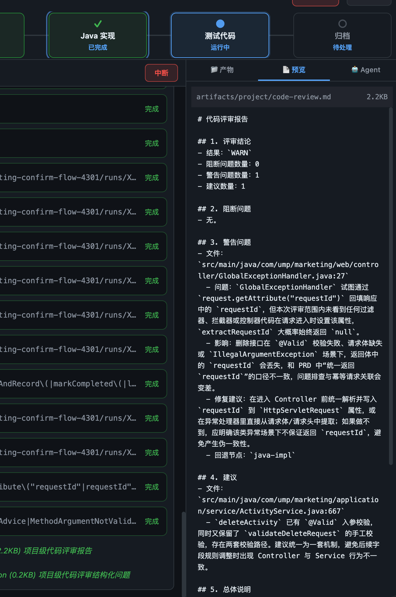

核心产物：

- `artifacts/<project>/changed-files.json`
- `artifacts/<project>/code-preview-manifest.json`
- `artifacts/<project>/changed-files/*`
- `artifacts/<project>/code-review.md`
- `artifacts/<project>/review-findings.json`

演示讲解点：

- 变更代码会反映到右侧产物列表。
- review 发现 BLOCK 时会自动回退到 `Java Impl` 修复。
- 回退不会覆盖上一轮工具轨迹，页面会保留每一轮执行记录。

## 8. 测试代码生成和单元测试执行

`Test Code Generate` 节点负责生成测试代码，并直接运行 Maven 单元测试。

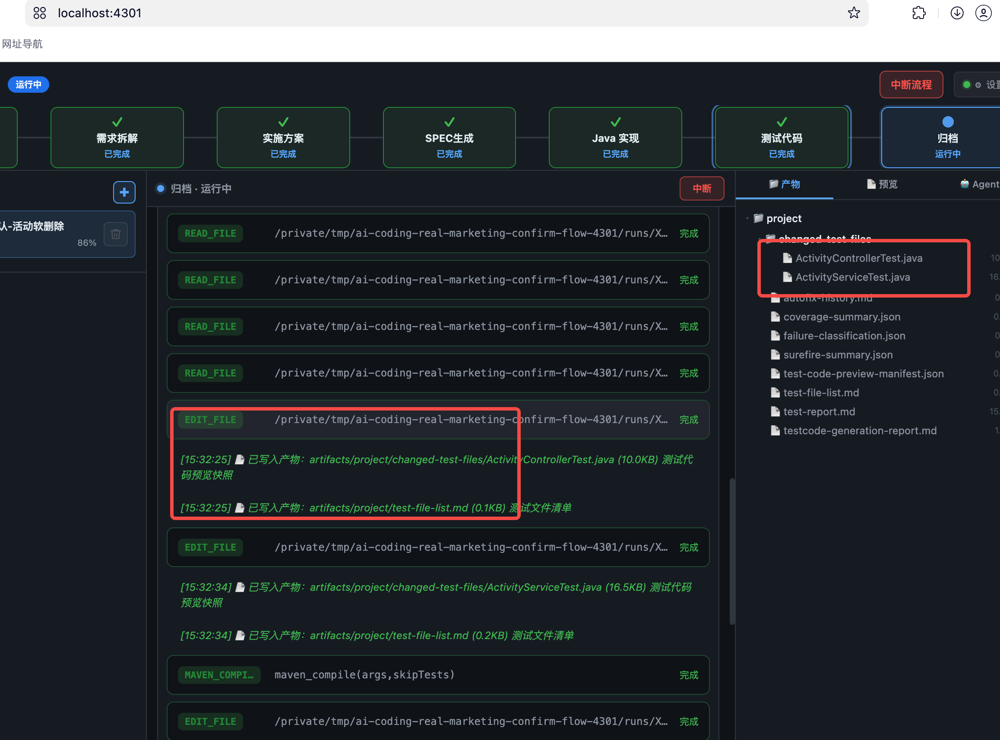

执行 Maven 测试时会展示命令、输出和结果分类。

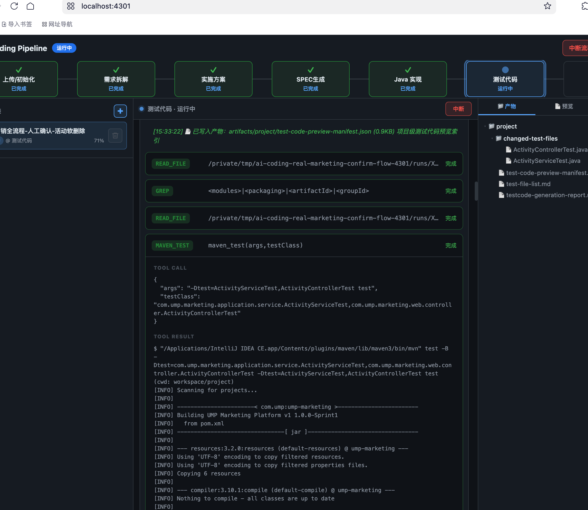

测试通过后展示测试报告。

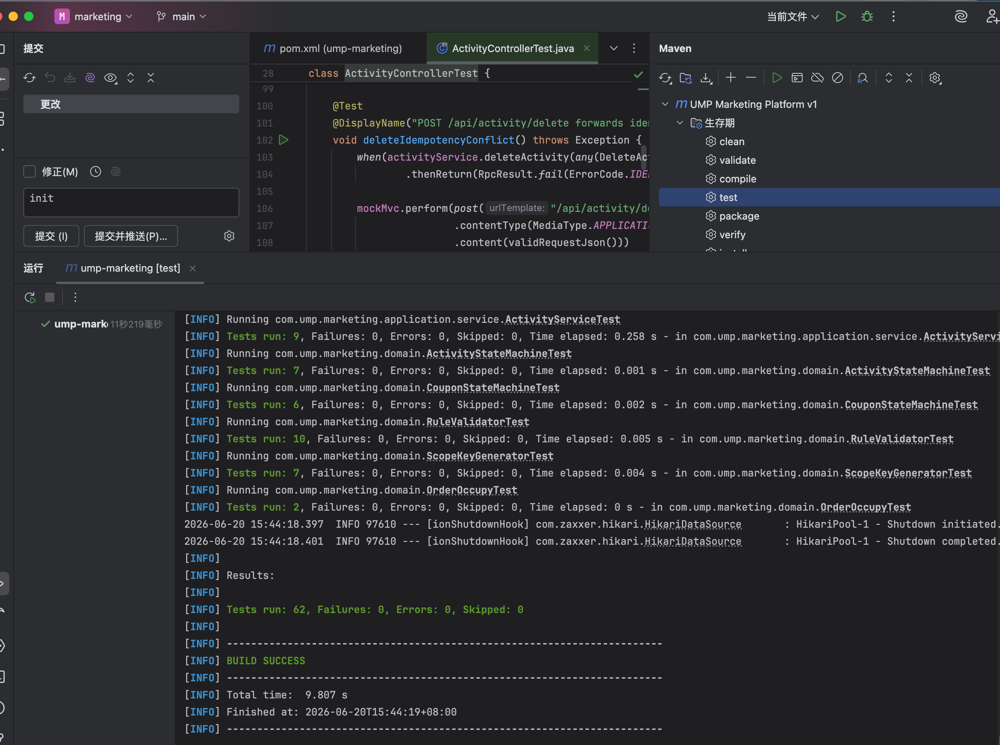

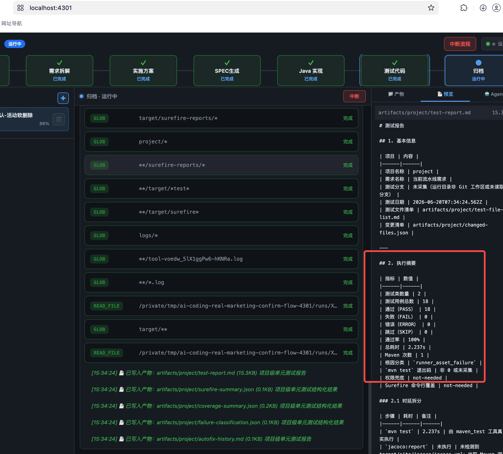

核心产物：

- `artifacts/<project>/changed-test-files/*`
- `artifacts/<project>/test-file-list.md`
- `artifacts/<project>/testcode-generation-report.md`
- `artifacts/<project>/test-report.md`
- `artifacts/<project>/surefire-summary.json`
- `artifacts/<project>/coverage-summary.json`
- `artifacts/<project>/failure-classification.json`
- `artifacts/<project>/autofix-history.md`

演示讲解点：

- 测试失败会分类：实现问题回退到 `Java Impl`，测试问题回退到当前节点。
- 自动重试有上限，超过后进入等待人工修复状态。
- 测试报告会记录 Maven 结果、用例数量、失败分类和覆盖率可用性。

## 9. 产物实时刷新

工具写入产物后，右侧产物区域会刷新，用户可以及时看到新增或修改文件。

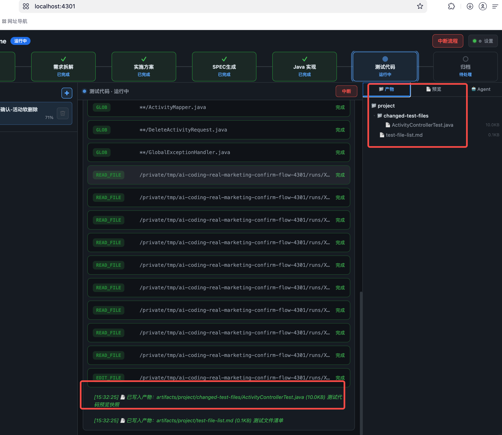


演示讲解点：

- 产物不是流程结束后一次性展示。
- `write_file`、`edit_file` 等工具事件会驱动产物索引更新。
- 用户可以在节点执行中确认模型是否真的写了文件。

## 10. 归档

`Archive` 节点会汇总需求、方案、Spec、代码变更、测试报告、工具耗时、节点耗时和 token 消耗。

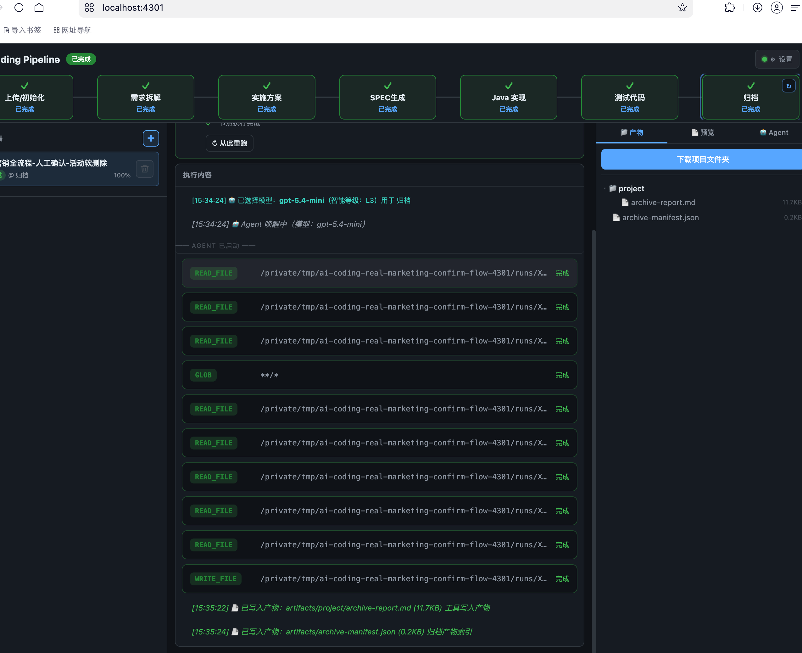

最终可以下载修改后的项目包。


核心产物：

- `artifacts/<project>/archive-report.md`
- `artifacts/archive-manifest.json`
- `downloads/<runId>-projects.zip`

演示讲解点：

- 归档报告是交付说明，不只是文件索引。
- 报告内会记录每个节点的执行时间、工具调用时间和 token 消耗。
- 最终下载包来自当前 run 的 workspace/project。

## 11. 演示话术建议

建议按下面顺序演示：

1. 先打开自动加载的 `完整流程演示 Demo`，展示最终全链路结果。
2. 点击每个节点，说明左侧是流程状态，中间是执行轨迹，右侧是节点产物。
3. 展示需求拆解确认页，说明用户如何参与澄清。
4. 展示 Java 实现节点的工具轨迹，强调是真实读写代码。
5. 展示测试节点的 Maven 执行和报告。
6. 展示归档报告和项目下载。
7. 最后新建一个任务，说明用户自己的 MRD 和项目可以走同样流程。

## 12. 当前产品边界

- 当前是固定 MRD-to-Code 流水线，不是通用工作流编排器。
- 主要面向 Java/Maven 项目。
- 自动 Demo 默认开启，可用 `AI_CODING_AUTO_DEMO=0` 关闭。
- 运行态数据位于 `runtime-projects/` 或 `RUNTIME_DIR` 指定目录，不应提交到 Git。
- 模型 API Key 和本地配置位于 `.ai-coding/`，不应提交到 Git。
