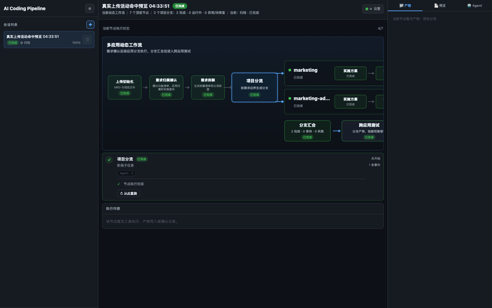
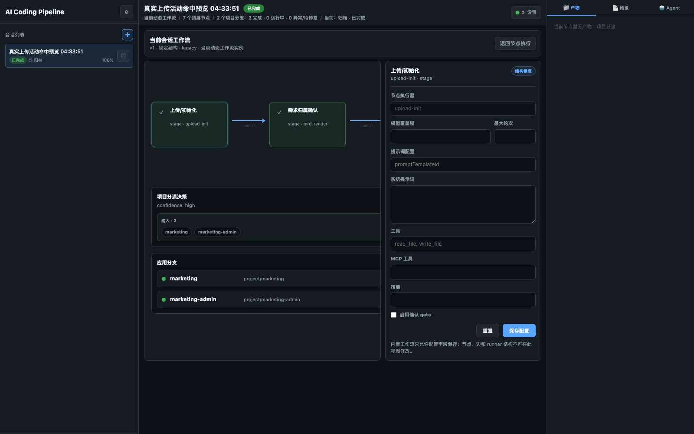
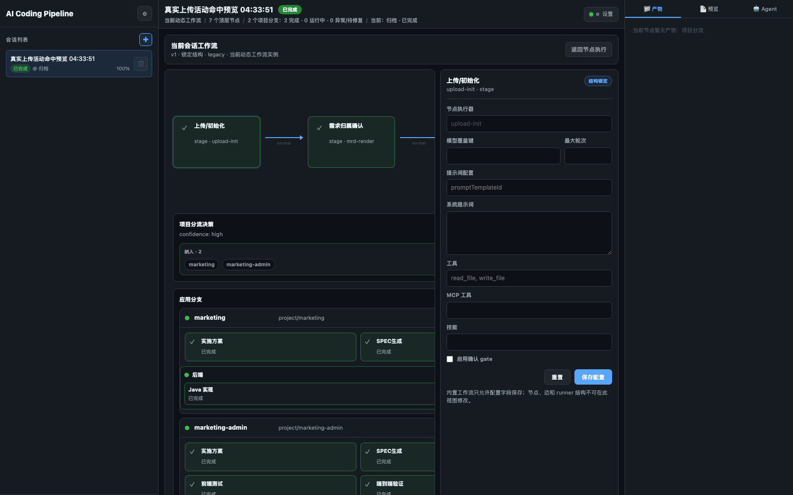
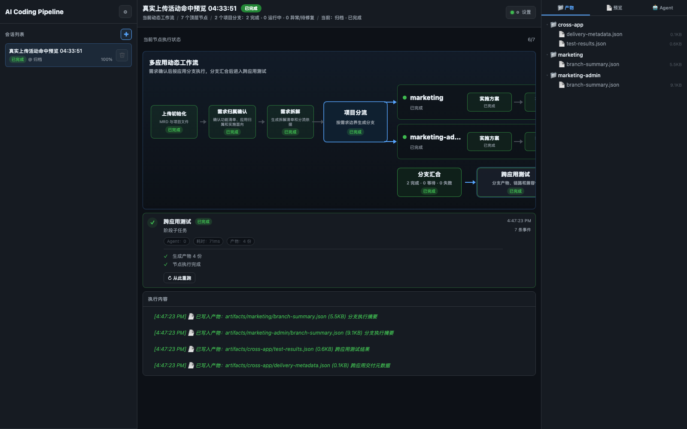
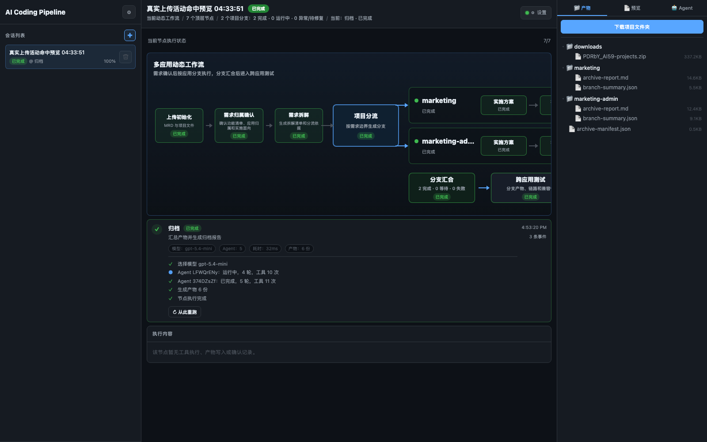

# 产品演示流程

相关文档：[README](../README.md) ｜ [GitHub 分享稿](activity-hit-preview-demo.md) ｜ [架构设计](architecture.md) ｜ [节点设计](node-design.md) ｜ [节点流转设计](node-transition.md) ｜ [动态工作流读模型](session-dynamic-workflow.md)

本文档用于演示 AI Coding Pipeline 的当前产品链路。演示数据来自真实上传并跑通的“活动命中预览”需求，涉及 `marketing` 和 `marketing-admin` 两个项目。服务启动后默认注入为 `活动命中预览 Demo`。

## 1. 打开首页

启动服务后进入首页，左侧会话列表出现 `活动命中预览 Demo`。选择会话后，可以看到本次 session 的动态工作流已经完成到 `归档`。



演示讲解点：

- 这是一次真实运行快照，不是前端写死的假数据。
- 节点、事件、Agent 状态、工具调用、产物、E2E 截图都来自同一个 run。
- 当前主流程不是旧的单项目固定流水线，而是 session 内动态生成的多应用工作流。

## 2. 输入与上传初始化

本 case 的输入包括：

- `activity-hit-preview-mrd.md`
- `marketing`
- `marketing-admin`

`上传初始化` 会写入：

- `artifacts/input-summary.md`
- `artifacts/project-manifest.json`

`project-manifest.json` 不只记录项目列表，还会记录 Java/Maven、Spring Boot、前端资源、启动命令、readiness 端点、API base URL 约定和 Playwright 配置等能力证据。

## 3. 需求归属确认

需求拆解阶段会先形成需求边界、项目归属和需要用户确认的问题。确认后，系统把用户反馈写回节点上下文，再产出正式的需求事实。

核心产物：

- `artifacts/mrd-clarified.md`
- `artifacts/mrd-clarify-questions.md`
- `artifacts/requirement-ownership.json`

演示讲解点：

- 需求归属确认不是简单复述 MRD，而是把功能范围、项目归属、包含/不包含项和风险明确下来。
- 下游节点读取正式产物，不依赖临时对话 transcript。

## 4. 项目分流

`项目分流` 根据 MRD 归属和上传项目 manifest 生成 fanout 决策。

核心产物：

- `artifacts/fanout-decision.json`

本 case 的决策：

- 纳入：`marketing`、`marketing-admin`
- 排除：无
- 未解析：无
- confidence：`high`



演示讲解点：

- `workflowInstance` 是 run 级别读模型，保存本次 session 的真实拓扑。
- 可复用 workflow 模板不会因为分支生成而被修改。
- 历史旧 run 仍可通过 legacy fallback 渲染。

## 5. 应用分支和 Tracks

项目分流后，每个应用生成独立分支。分支内根据项目能力生成 track。

本 case 的分支结构：

```text
marketing
  -> 实施方案
  -> SPEC 生成
  -> backend: Java 实现 -> Backend Test

marketing-admin
  -> 实施方案
  -> SPEC 生成
  -> backend: Java 实现 -> Backend Test
  -> frontend: Frontend Implementation -> Frontend Test
  -> e2e: E2E Verify
```



演示讲解点：

- `marketing` 是后端服务，只生成 backend track。
- `marketing-admin` 同仓包含后端接口和静态前端，因此生成 backend、frontend、E2E track。
- 分支和 track 都有独立状态，某一条 track 失败不会覆盖其他 track 的完成产物。

## 6. 实施方案与 OpenSpec

每个应用分支都会生成项目级技术方案和 OpenSpec 任务。

核心产物：

- `artifacts/implementation-plan-manifest.json`
- `artifacts/<project>/tech-design.md`
- `artifacts/<project>/openspec-task.md`
- `artifacts/<project>/openspec-test-task.md`
- `artifacts/<project>/openspec/changes/run-<runId>-<project>/tasks.md`

演示讲解点：

- 技术方案按应用隔离，避免多项目需求互相污染。
- OpenSpec 任务在同一份 `tasks.md` 内保留 Development、Test、Backend、Frontend、E2E 等 section。
- 实现和测试完成后会在原任务清单上打勾。

## 7. 代码实现和审查

`Java Impl`、`frontend-impl` 等节点会通过工具真实读写项目代码。

典型产物：

- `artifacts/<project>/changed-files.json`
- `artifacts/<project>/changed-files/*`
- `artifacts/<project>/code-preview-manifest.json`
- `artifacts/<project>/code-review.md`
- `artifacts/<project>/review-findings.json`
- `artifacts/<project>/frontend-implementation-report.md`

演示讲解点：

- 页面中间展示 Agent 文本、工具调用、编译和审查轨迹。
- 右侧产物树会按当前应用/track 自动过滤。
- review 发现 BLOCK 时会触发当前分支内的回退修复。

## 8. 测试和 E2E 验证

后端 track 执行 Maven 编译和单元测试。前端 track 执行前端实现/测试报告。E2E track 由平台 runner 启动应用并执行 Playwright 验证。

典型产物：

- `artifacts/<project>/test-report.md`
- `artifacts/<project>/surefire-summary.json`
- `artifacts/<project>/coverage-summary.json`
- `artifacts/<project>/failure-classification.json`
- `artifacts/<project>/frontend-test-report.md`
- `artifacts/<project>/frontend-test-summary.json`
- `artifacts/<project>/e2e/verification-summary.md`
- `artifacts/<project>/e2e/screenshots/home.png`
- `artifacts/<project>/e2e/e2e-summary.json`

演示讲解点：

- `marketing-admin` 的 E2E 验证会记录后端启动、前端启动、API smoke、Playwright 输出和截图。
- 如果浏览器二进制不可用，平台会记录有限 HTTP fallback，而不是把环境问题当成产品缺陷。

## 9. 跨应用测试

所有分支完成后进入 `跨应用测试`，汇总分支交付状态、测试结果和跨应用风险。

核心产物：

- `artifacts/marketing/branch-summary.json`
- `artifacts/marketing-admin/branch-summary.json`
- `artifacts/cross-app/test-results.json`
- `artifacts/cross-app/delivery-metadata.json`



演示讲解点：

- join 节点会等待所有分支进入终态。
- 跨应用测试读取分支 summary，而不是重新扫描所有 transcript。
- delivery metadata 说明当前交付是否 ready。

## 10. 归档和下载

`归档` 生成项目级报告、跨应用 manifest 和最终项目包。

核心产物：

- `artifacts/marketing/archive-report.md`
- `artifacts/marketing-admin/archive-report.md`
- `artifacts/archive-manifest.json`
- `artifacts/downloads/<runId>-projects.zip`



演示讲解点：

- 归档报告包含需求摘要、技术方案、变更文件、测试结果、风险和执行指标。
- 下载包来自当前 run 的 `workspace/project`，不是 fixture 原目录。
- 归档不会抹掉前面节点的工具轨迹。

## 11. 演示话术建议

建议按下面顺序演示：

1. 先打开自动加载的 `活动命中预览 Demo`，说明这是双项目真实运行快照。
2. 点击 `项目分流`，解释 MRD 如何映射到 `marketing` 和 `marketing-admin`。
3. 展开应用分支，说明 backend、frontend、E2E track 的差异。
4. 点击某个分支节点，展示按应用和 track 过滤后的产物。
5. 展示 `marketing-admin/e2e` 下的验证摘要和截图。
6. 点击 `跨应用测试`，说明 join 后如何汇总分支结果。
7. 点击 `归档`，展示项目报告和下载包。
8. 最后点击 `新建任务`，说明用户自己的 MRD 和多个项目会生成新的 session workflow。

## 12. 当前产品边界

- 当前不是通用拖拽工作流编辑器，而是面向 MRD-to-Code 的动态应用工作流。
- `legacy` runtime 仍是默认执行器，`workflowInstance` 负责 session 读模型和动态 UI；LangGraph runtime 仍按配置灰度。
- 主要验证路径覆盖 Java/Maven、Spring Boot、静态前端和平台 E2E。
- Track 级 rerun/cancel 已在运行态表示，完整 UI/API 控制仍在演进。
- 自动 Demo 默认开启，可用 `AI_CODING_AUTO_DEMO=0` 关闭。
